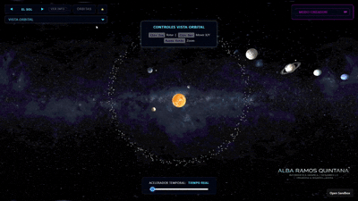
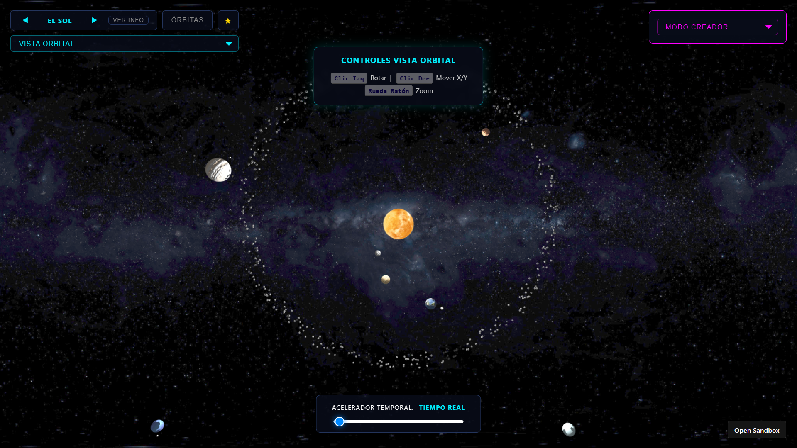
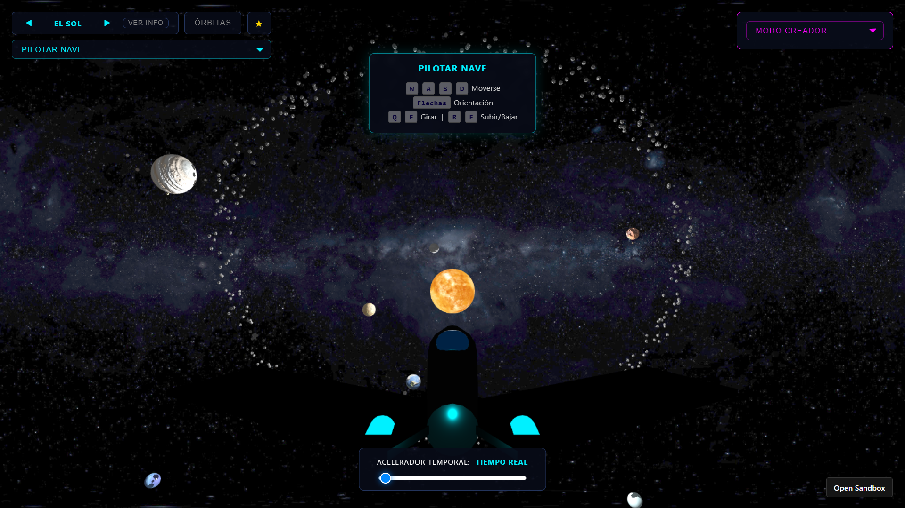
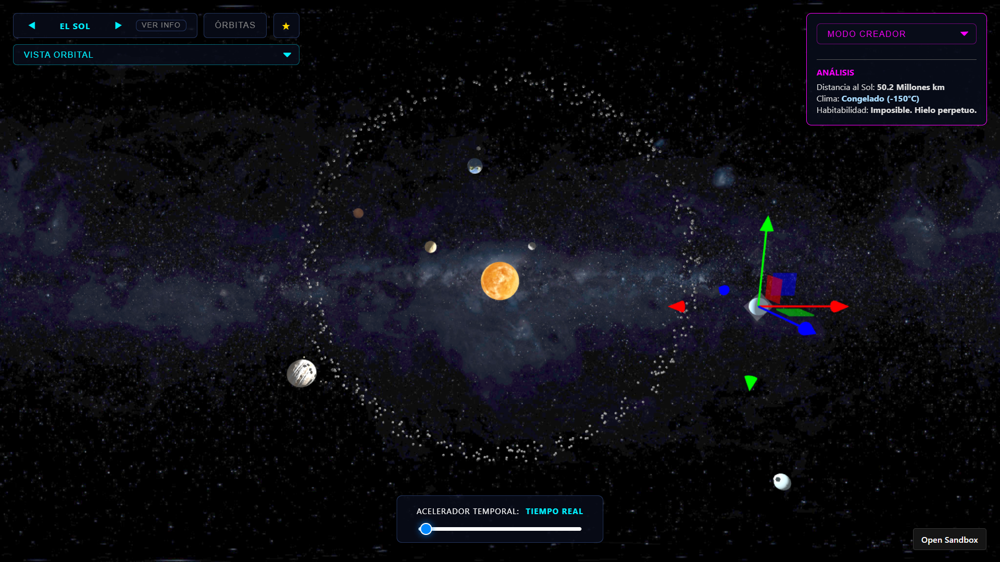
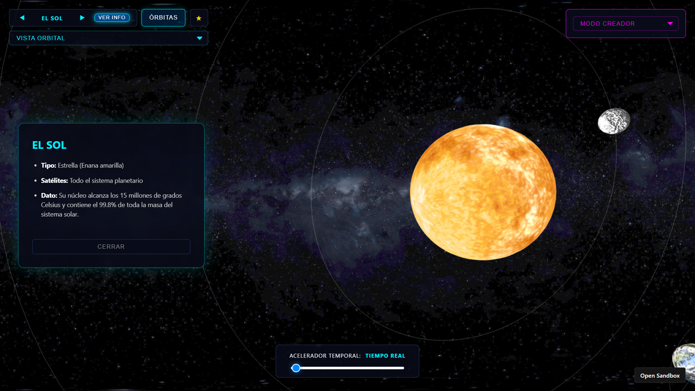
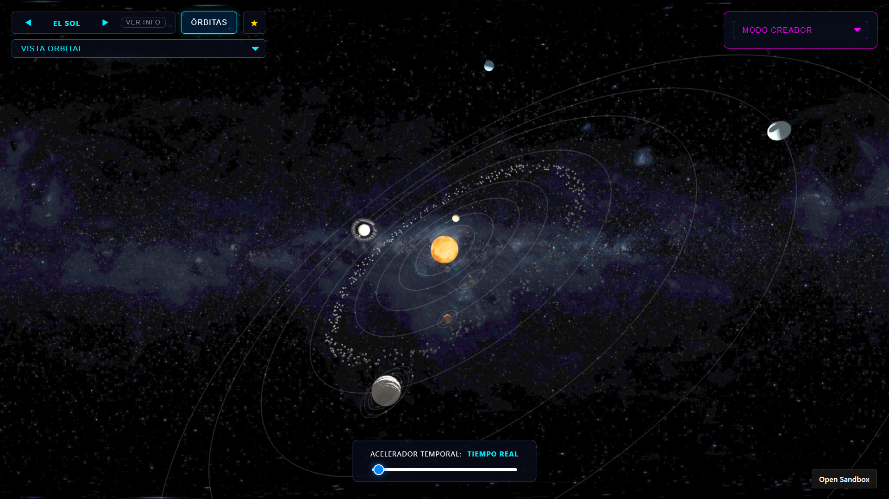
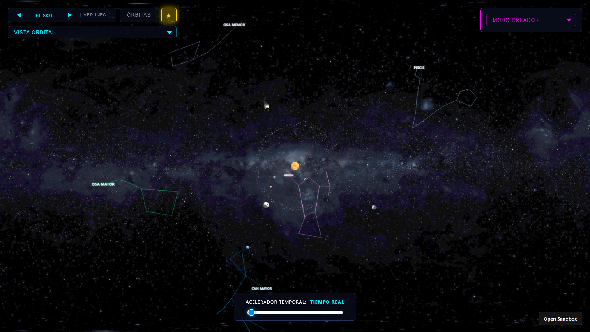
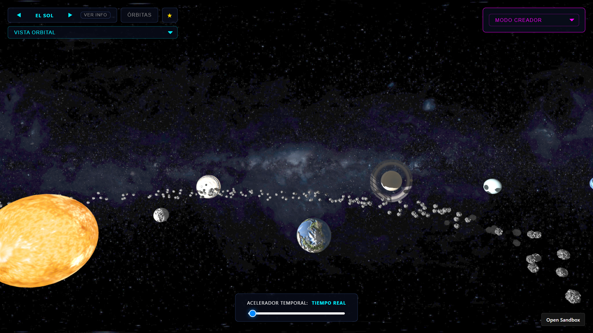

# Práctica 6 - Sistema Planetario Interactivo 

## [Alba Ramos Quintana](https://github.com/albaquiintanaa)

<p align="center">
  
</p>


<p align="center">
  <a href="https://youtu.be/sZ4i7rHd4BQ"><em>Enlace al vídeo de demostración de la aplicación</em></a>
</p>

Explora el Sistema Solar en una experiencia 3D interactiva: recorre los planetas y sus lunas, cambia entre la vista orbital y el pilotaje de una nave, consulta información de cada astro y activa órbitas y constelaciones. Además, podrás acelerar el paso del tiempo y crear planetas para descubrir cómo influye su distancia al Sol en su clima y habitabilidad. ¡Tu aventura espacial empieza aquí!

**Enlace a CodeSandbox:** [Abrir en CodeSandbox](https://codesandbox.io/p/sandbox/github/albaquiintanaa/IG_PRACTICAS/tree/main/P6)

---

## Contenidos

1. [Introducción y Enfoque](#introducción-y-enfoque)
2. [Modos de Visualización e Interacción](#modos-de-visualización-e-interacción)
   1. [Vista Orbital](#vista-orbital)
   2. [Pilotar Nave](#pilotar-nave)
   3. [Modo Creador](#modo-creador)
   4. [Interfaz y Controles (HUD)](#interfaz-y-controles-hud)
3. [Elementos del Espacio (Objetos 3D)](#elementos-del-espacio-objetos-3d)
4. [Cámaras y Controles](#cámaras-y-controles)
5. [Sistema de Colisiones](#sistema-de-colisiones)
6. [Iluminación y Sombras](#iluminación-y-sombras)
7. [Fuentes](#fuentes)
8. [Nota: Uso de IA](#nota-uso-de-ia)

---

## Introducción y Enfoque 

Este proyecto es un simulador interactivo de un sistema planetario construido con **Three.js**. No se trata solo de una representación visual estática, sino de una herramienta orientada a la divulgación científica y la interactividad.

El proyecto cumple con los requisitos base exigidos y se ha enriquecido visual y funcionalmente con características "extra" orientadas a todos los públicos, destacando un modo creador interactivo y un sistema de constelaciones.

---

## Modos de Visualización e Interacción

El simulador cuenta con una interfaz autodescriptiva que despliega notificaciones *Toast* con los controles al cambiar de modo, ocultándose a los 6 segundos para no interferir con la experiencia.

### Vista Orbital
Es el modo principal por defecto, diseñado como una vista panorámica en **tercera persona** a gran escala. Permite observar el sistema solar en su totalidad desde el exterior, contemplando simultáneamente todos los planetas junto a sus satélites y el cinturón de asteroides. A través de este modo, el usuario puede navegar libremente con el ratón para rotar alrededor del el Sol, moverse en los ejes X e Y, y aplicar zoom.



### Pilotar Nave
Este modo ofrece una experiencia diferente mediante un efecto de **primera persona** desde la cabina de una nave espacial (modelada detalladamente con primitivas geométricas, cristales translúcidos y luces dinámicas). Haciendo uso de la herramienta `FlyControls`, el usuario tiene total libertad para pilotar, girar y desplazarse por el vacío tridimensional del espacio. 
- La característica más destacada de este modo es la **exploración interactiva**: al navegar por el sistema y acercarte lo suficiente a cualquier planeta o estrella, el radar de a bordo lo detecta, permitiéndote abrir un panel con información detallado, características técnicas y curiosidades sobre el astro que estás visitando.



### Modo Creador 
Esta funcionalidad transforma el simulador en un laboratorio interactivo de astrofísica. Utilizando la herramienta `TransformControls` de Three.js, el usuario tiene el poder de **añadir astros completamente nuevos, arrastrarlos libremente por el espacio tridimensional y eliminarlos** de la escena cuando lo desee.

- La principal característica es su **motor de evaluación climática en tiempo real**. Al agarrar y desplazar un planeta recién creado, el sistema calcula matemáticamente su distancia exacta respecto al Sol. En función de esta lejanía, la simulación determina y actualiza al instante las condiciones del astro.

> Todos estos cambios termodinámicos se reflejan instantáneamente tanto en el color de la malla 3D como en el panel analítico en pantalla.

```javascript
// Evaluación termodinámica en tiempo real en el Modo Creador
transformControl.addEventListener('change', function () {
    if (transformControl.object && modoEdicionActivo) {
      let astro = transformControl.object;
      let distancia = astro.position.length(); 
      let clima, colorHex;

      // Según la distancia al Sol, determinamos si el astro es habitable o no
      if (distancia < 17) {
        clima = "Abrasador (+400°C)"; colorHex = 0xff3300; 
      } else if (distancia >= 17 && distancia <= 30) {
        clima = "Templado (15°C)"; colorHex = 0x00ff88; 
      } else {
        clima = "Congelado (-150°C)"; colorHex = 0xaaddff; 
      }
      astro.material.color.setHex(colorHex);
    }
});
```




### Interfaz y Controles (HUD)

En la parte superior se encuentran herramientas clave para interactuar con la escena de forma rápida:

* **Visor de Astros y Botón "Ver Info":** Un carrusel permite navegar entre cuerpos celestes. Al hacer clic en "Ver Info", la simulación entra en *Modo Cinemático*, anclando la cámara al planeta y desplegando un panel informativo (HUD) con datos inyectados vía `userData`. Para cerrar el panel, puedes pulsar «Cerrar», volver a pulsar «Ver Info» o presionar la tecla **Q**.




* **Botón "Órbitas":** Dibuja u oculta las trayectorias elípticas iterando sobre un array de líneas instanciadas, permitiendo visualizar de forma clara tanto las órbitas de los planetas alrededor del Sol como las de los satélites alrededor de sus respectivos planetas.




* **Botón "Constelaciones" (★):** Enciende o apaga el firmamento estelar geométrico, revelando las constelaciones más importantes del cielo nocturno junto con la de Piscis.

> 💡 **Dato:** Se ha incluido la constelación de Piscis como un detalle personal en la práctica, ya que es mi signo del zodiaco y me hacía especial ilusión añadirla al proyecto.





* **Acelerador Temporal:** Un control deslizante que multiplica la variable global de tiempo para acelerar, ralentizar o pausar por completo el universo *(tiempo/segundo)*. La simulación arranca por defecto en **tiempo real**, y al desplazar el deslizador aparece un botón dinámico de reinicio (↺) que permite al usuario restaurar la velocidad normal con un solo clic.

```javascript
// función que controla el deslizador en función de la aceleración global
function actualizarVelocidad(valor) {
    aceleracionGlobal = valor;
    slider.value = valor;

    if (valor === 0) {
      textoVelocidad.innerText = "Pausado";
      btnReset.style.display = "inline-block"; 
    } else if (valor <= 0.0001) {
      textoVelocidad.innerText = "Tiempo Real";
      btnReset.style.display = "none"; 
    } else if (valor < 0.001) {
      let dias = Math.round((valor / 0.0001) * 10); 
      textoVelocidad.innerText = dias + " Días / seg";
      btnReset.style.display = "inline-block";
    } else if (valor < 0.005) {
      let meses = Math.round((valor / 0.001) * 3);
      textoVelocidad.innerText = meses + " Meses / seg";
      btnReset.style.display = "inline-block";
    } else {
      let anos = Math.round(valor / 0.001);
      textoVelocidad.innerText = anos + " Años / seg";
      btnReset.style.display = "inline-block";
    }
  }
```

---

## Elementos del Espacio (Objetos 3D)

La lógica constructiva se ha desacoplado y desarrollado en módulos independientes (`objects.js`, `constellations.js`) que se importan directamente en `main.js`. Esta arquitectura permite instanciar cuerpos celestes complejos mediante funciones parametrizadas, facilitando la escalabilidad del sistema.

A nivel técnico, se han programado las siguientes funciones generadoras:

* **`Estrella()` (El Sol):** Crea la malla central utilizando una `SphereGeometry`. Para simular que es una fuente de luz autónoma, se le aplica un `MeshBasicMaterial`, el cual no se ve afectado por la iluminación externa ni genera sombras sobre sí mismo, complementándose con los mapas de texturas (`map` y `bumpMap`).

* **`Planeta()`:** Se encarga de instanciar los 8 planetas. Emplea `SphereGeometry` y `MeshPhongMaterial` para reaccionar a la luz del Sol (brillos y sombras). Técnicamente, su rotación no se calcula directamente sobre el planeta, sino que se anida dentro de un `THREE.Object3D()` invisible en el centro del sistema que actúa como **pivote**. Además, la función traza automáticamente la línea de su trayectoria usando `THREE.EllipseCurve`.

* **`EsferaHija()` (Atmósferas):** Diseñada para Venus y la Tierra. Crea una esfera iterativa con un radio ligeramente superior al planeta padre. El secreto de su efecto atmosférico reside en el uso de un material con las propiedades `transparent: true`, `depthWrite: false` y renderizado a doble cara (`THREE.DoubleSide`), aplicando las nubes a través de un `alphaMap` para permitir ver la corteza del planeta a través de los huecos nubosos.

* **`Luna()` y `Anillo()`:** La función `Luna()` opera como un mini-planeta, pero anclando su `Object3D` pivotante al centro del planeta padre en lugar del Sol. Por su parte, `Anillo()` genera los anillos de Saturno usando `THREE.RingGeometry`. Para lograr que la textura de bandas de hielo se aplique correctamente en círculo, se ha programado un **bucle de recálculo de coordenadas UV** (`geometry.attributes.uv.setXY`), interpolando los vértices entre el radio interior y exterior.

* **`CinturonAsteroides()`:** Crea un agrupador (`Object3D`) que instancia 400 primitivas de tipo `DodecahedronGeometry` (baja poligonización para optimizar el rendimiento). Se utiliza trigonometría (`Math.cos` y `Math.sin`) junto con `Math.random()` para esparcir las rocas en un anillo entre un radio mínimo y máximo, aplicando un "ruido" aleatorio en su posición Z y rotación para darle un aspecto orgánico y caótico.

* **`crearConstelaciones()`:** Para el firmamento profundo, el sistema toma coordenadas X, Y, Z relativas, las normaliza (`.normalize()`) y las multiplica por un radio masivo (600 unidades) para proyectarlas en el fondo infinito. Se dibujan las uniones estelares con `THREE.Line`. Los nombres de las constelaciones no son texto HTML, sino que **se dibujan dinámicamente en un `<canvas>` oculto** (aplicando `shadowBlur` para el efecto neón brillante), el cual se inyecta como textura dentro de un `THREE.SpriteMaterial`. 

> Al usar *Sprites*, las etiquetas siempre miran a la cámara independientemente del ángulo de rotación.

```javascript
// Instanciación limpia y modular en main.js (Ejemplo: La Tierra y sus capas)
let tierra = Planeta(scene, planetas, orbitas, 1.5, 24, 0.8, 0xffffff, 1.0, 1.0, txTierra, 0.0);
// Se inyecta la capa atmosférica (nubes) vinculada al planeta Tierra
EsferaHija(tierra, atmosferas, 1.52, 40, 40, 0xffffff, txNubes, undefined, undefined, txNubes);
// Se anida el satélite (Luna) con su propia órbita y velocidad
Luna(tierra, lunas, orbitas, 0.4, 3.5, 3.0, 0xffffff, txLuna, 0.1);
```

---

## Cámaras y Controles

Para evitar saltos bruscos y manejar distintos contextos, la escena renderiza la variable genérica `camaraActiva`, la cual se intercambia dinámicamente entre **3 cámaras especializadas**:

1. **`camera` (Cámara Principal):** Con `OrbitControls`. Fija su objetivo en el origen y se usa para el Modo Orbital y el Modo Creador.

2. **`camaraNave` (Cámara Subjetiva):** Anidada permanentemente al `grupoNave`. Al moverse mediante `FlyControls`, hereda la posición y rotación automáticamente.

3. **`camaraCinematica` (Dron de Información):** Entra en acción al pulsar **"Ver Info"**. Calcula la posición mundial del astro (`getWorldPosition`), teletransporta la cámara cerca de él y lo persigue con la función `lookAt()`.

```javascript
// Fragmento de transición fluida hacia la cámara cinemática
function abrirInfo(planetaTarget) {
  if (enCinematica) return; 
  enCinematica = true;
  planetaEnfoque = planetaTarget; // Variable objetivo para el lookAt en el bucle
  
  document.getElementById("info-titulo").innerText = planetaTarget.userData.nombre;
  document.getElementById("info-desc").innerHTML = planetaTarget.userData.infoHtml;
  
  camaraActiva = camaraCinematica; // Cambio dinámico de cámara
  document.getElementById("panel-info").style.display = "block";
}
```

---

## Sistema de Colisiones

Para que el pilotajecde la nave espacial mejore, se ha desarrollado un motor básico de físicas reactivas. En cada iteración de `requestAnimationFrame`, se calcula la **distancia euclidiana** entre la nave y todos los objetos celestes. Si la nave invade el radio de un planeta + un umbral definido, se calcula un vector inverso para "rebotarla" y bloquear su paso.

```javascript
// Detección matemática de colisiones en tiempo real
if (camaraActiva === camaraNave) {
    let posNave = new THREE.Vector3();
    nave.getWorldPosition(posNave);
    let cuerposCelestes = planetas.concat(lunas); 
    
    for (let cuerpo of cuerposCelestes) {
      let posCuerpo = new THREE.Vector3();
      cuerpo.getWorldPosition(posCuerpo);
      let radioCuerpo = cuerpo.geometry ? cuerpo.geometry.parameters.radius : 1.0;
      
      let distancia = posNave.distanceTo(posCuerpo);
      let distanciaMinimaPermitida = radioCuerpo + 2.0; // Radio planeta + Radio nave
      
      if (distancia < distanciaMinimaPermitida) {
         let direccionRebote = new THREE.Vector3().subVectors(posNave, posCuerpo).normalize();
         let nuevaPosicion = posCuerpo.clone().add(direccionRebote.multiplyScalar(distanciaMinimaPermitida));
         nave.position.copy(nuevaPosicion); // Corrección de posición (Rebote)
      }
    }
}
```

---

## Iluminación y Sombras

El fotorrealismo se consigue combinando `PCFSoftShadowMap` (para sombras difuminadas) y mapas de relieve (`bumpMap`) en los materiales `MeshPhongMaterial`.

* **AmbientLight:** Luz de relleno (intensidad 0.15) blanca que simula la dispersión residual en el vacío.

* **PointLight Central (Sol):** Proyecta sombras direccionales masivas (`castShadow = true`, mapa 2048x2048), logrando que los planetas den sombra a sus propios anillos o lunas.



*Imagen en la que se aprecian las sombras de Saturno, de la Tierra al pasar y del cinturón de asteroides.*

* **PointLights Navales:** Faro de exploración frontal y un motor lumínico trasero de color cian anclados al chasis de la nave.

```javascript
// Configuración de la estrella principal y su proyección fotónica
const luzPuntual = new THREE.PointLight(0xffffff, 2.5, 800); 
luzPuntual.position.set(0, 0, 0);
luzPuntual.castShadow = true;
luzPuntual.shadow.mapSize.width = 2048; // Sombras en alta resolución
luzPuntual.shadow.mapSize.height = 2048;
scene.add(luzPuntual);
```

---

## Fuentes

* **Documentación Oficial Three.js:** [https://threejs.org/docs/](https://threejs.org/docs/)
* **Discover Three.js (Arquitectura):** [https://discoverthreejs.com/book/](https://discoverthreejs.com/book/)
* **NASA Space Place (Datos astronómicos):** [https://spaceplace.nasa.gov/how-many-moons/sp/](https://spaceplace.nasa.gov/how-many-moons/sp/)
* **IEQFB - Geometría de Constelaciones:** [https://ieqfb.com/constelaciones-de-via-lactea/](https://ieqfb.com/constelaciones-de-via-lactea/)
* **Solar System Scope (Texturas):** [https://www.solarsystemscope.com/textures/](https://www.solarsystemscope.com/textures/)
* **DeviantArt (Texturas):** [https://www.deviantart.com/](https://www.deviantart.com/)

---

## Nota: Uso de IA

Durante la fase de pulido de esta práctica, se ha empleado Inteligencia Artificial como herramienta de asistencia técnica, bajo constante revisión y validación de la autora, para los siguientes apartados:

1. **Soporte Frontend (CSS):** Ajuste de parámetros Flexbox, *Media Queries* y refinado del efecto *Glassmorphism* para asegurar una interfaz limpia y enriquecedora.
2. **Documentación del README:** Organización estructural, indexación temática y presentación en formato Markdown de la memoria descriptiva de la práctica.

---