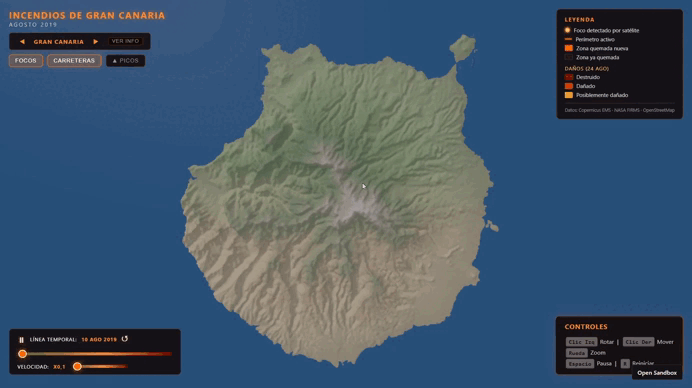
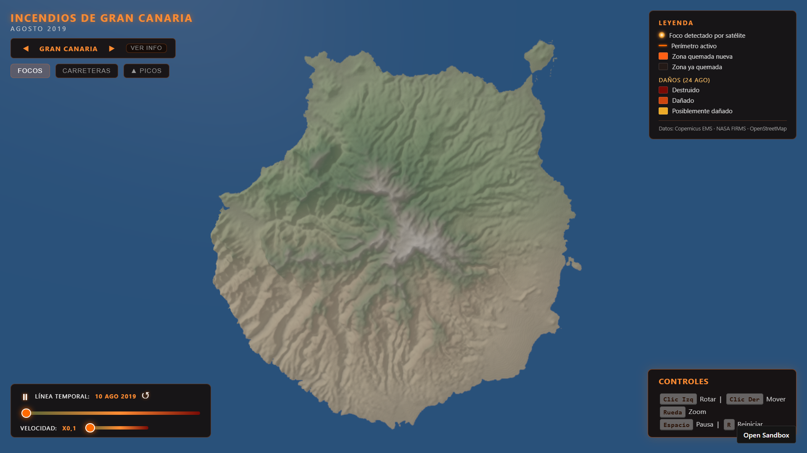
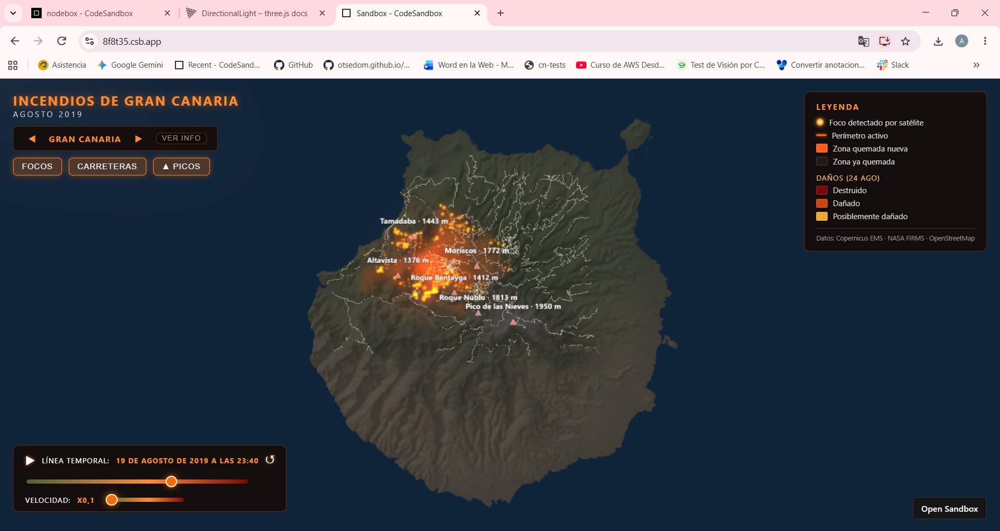
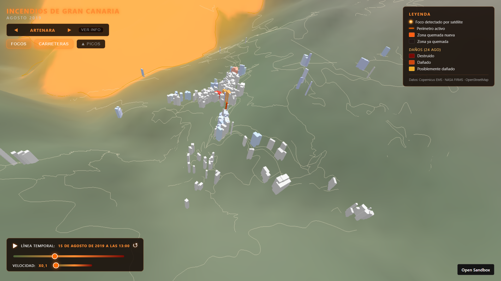
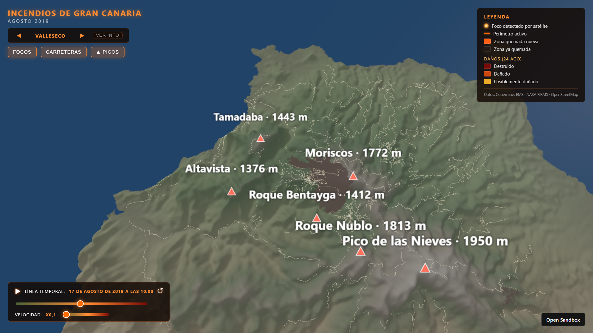
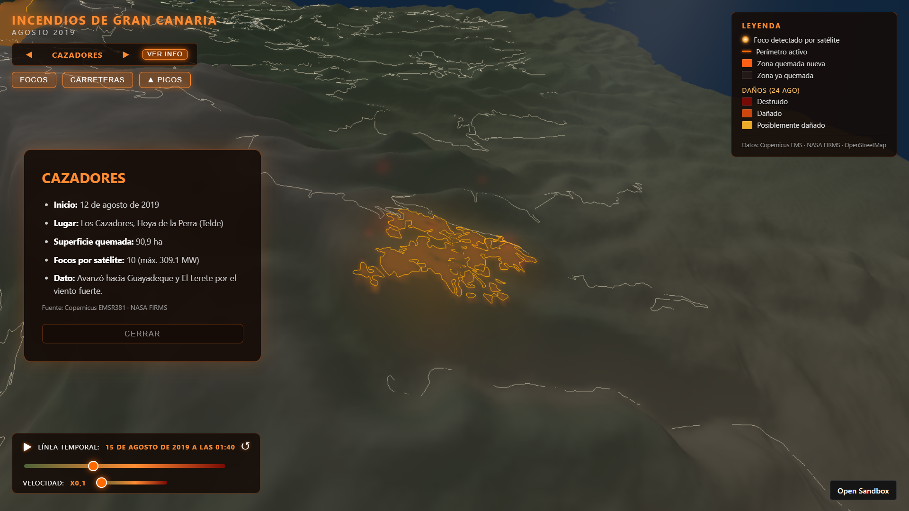
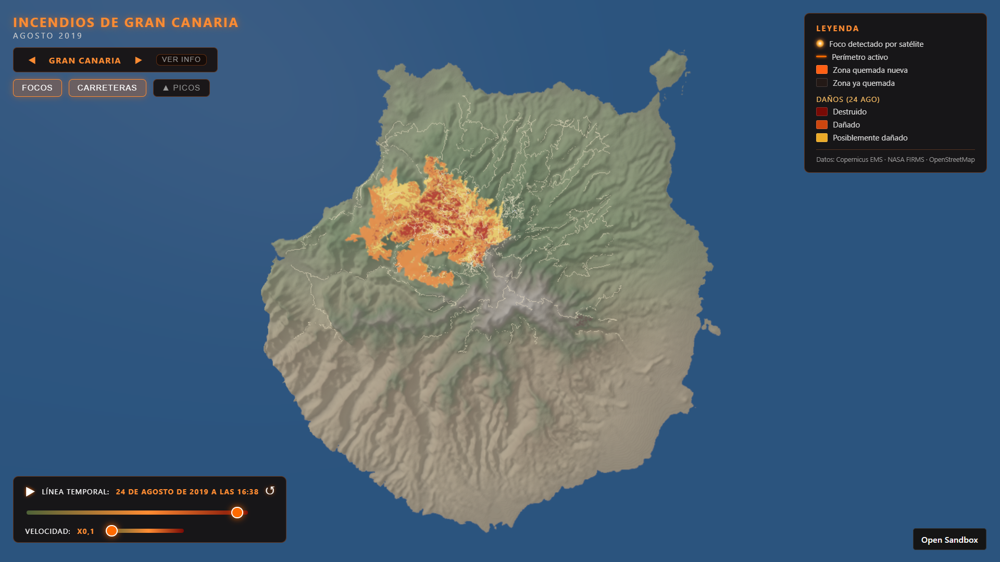

# Práctica 7 - Incendios de Gran Canaria (Agosto 2019)

## [Alba Ramos Quintana](https://github.com/albaquiintanaa)

<p align="center">
  
</p>


<p align="center">
  <a href="https://youtu.be/TvS6-CPiZfs"><em>Enlace al vídeo de demostración de la aplicación</em></a>
</p>

Revive y analiza la evolución de los devastadores incendios forestales que asolaron Gran Canaria en agosto de 2019 (Artenara, Cazadores y Valleseco). Esta visualización 3D interactiva combina topografía real, datos satelitales de áreas quemadas (Copernicus EMS), focos de calor detectados por satélite (NASA FIRMS) y la orografía urbana de los municipios afectados (OpenStreetMap). Observa cómo el fuego avanza sobre el relieve con el paso de los días y las noches.

**Enlace a CodeSandbox:** [Abrir en CodeSandbox](https://codesandbox.io/p/sandbox/github/albaquiintanaa/IG_PRACTICAS/tree/main/P7)

---

## Contenidos

1. [Introducción y Enfoque](#introducción-y-enfoque)
2. [Modos de Visualización e Interacción](#modos-de-visualización-e-interacción)
    1. [Evolución Temporal y Ciclo Día/Noche](#evolución-temporal-y-ciclo-díanoche)
    2. [Navegación y Vuelos de Cámara](#navegación-y-vuelos-de-cámara)
    3. [Gestión de Capas e Interfaz (HUD)](#gestión-de-capas-e-interfaz-hud)
3. [Elementos Geográficos y 3D](#elementos-geográficos-y-3d)
4. [Tratamiento y Visualización de Datos](#tratamiento-y-visualización-de-datos)
    1. [1. Perímetros de Incendio (Copernicus EMS)](#1-perímetros-de-incendio-copernicus-ems)
    2. [2. Focos de Calor Activos (NASA FIRMS)](#2-focos-de-calor-activos-nasa-firms)
5. [Iluminación, Ambiente y Clima](#iluminación-ambiente-y-clima)
6. [Arquitectura del Código](#arquitectura-del-código)
7. [Fuentes y Consultas de Datos](#fuentes-y-consultas-de-datos)
8. [Nota: Uso de IA](#nota-uso-de-ia)

---

## Introducción y Enfoque

Este proyecto da un salto desde la abstracción del espacio exterior hacia la geografía terrestre utilizando **Three.js**. La visualización se centra en un evento real y de gran impacto para Canarias: los incendios de agosto de 2019.

Cumpliendo con los requisitos de la práctica, se ha integrado un mapa de desplazamiento para generar terreno 3D realista, visualización de datos abiertos (Copernicus y NASA) y edificios/carreteras extraídos de OpenStreetMap. Se ha logrado proyectar dinámicamente los datos de satélite y asentar los polígonos urbanos (OSM) **directamente sobre la compleja orografía tridimensional** de la isla, superando la limitación de trabajar sobre planos lisos.

---

## Modos de Visualización e Interacción

El simulador mantiene la interfaz autodescriptiva (*Glassmorphism*) de la práctica anterior, con notificaciones *Toast* que indican los controles básicos al inicio de la simulación.
- Se sitúa en la esquina inferior derecha. 




### Evolución Temporal y Ciclo Día/Noche

La línea temporal inferior abarca del 10 al 25 de agosto de 2019. A medida que avanza el tiempo, el sistema interpola automáticamente un **ciclo completo de luz diurna y nocturna**.

* Durante el día, se aprecia con detalle el sombreado del terreno y los pueblos.
* Durante la noche, el mapa se oscurece y resaltan visualmente los **focos de calor** (satélites FIRMS) y el brillo anaranjado de las zonas recién quemadas, simulando la iluminación del fuego real.



### Navegación y Vuelos de Cámara

El entorno se explora libremente en tercera persona mediante `OrbitControls` (rotación, paneo y zoom). Además, se ha programado un sistema de **Vuelo Cinemático** (`VolarA`):
Al seleccionar una zona en el carrusel superior (Gran Canaria, Artenara, Cazadores o Valleseco), la cámara realiza un *lerp* (interpolación suave) calculando matemáticamente el centro del polígono del incendio afectado y ajustando el zoom dinámicamente para encuadrarlo.

### Gestión de Capas e Interfaz (HUD)

El panel superior aloja a la izquierda los botones para activar o desactivar capas, y a la derecha una leyenda con los mismos colores del mapa:

* **Focos:** Muestra/oculta las detecciones satelitales (partículas/sprites) de la NASA.
* **Carreteras:** Dibuja la red viaria y los modelos 3D de los edificios.



* **▲ Picos:** Marca con un triángulo y su nombre los picos principales (Pico de las Nieves, Roque Nublo, Roque Bentayga, Moriscos, Tamadaba y Altavista) con su altitud de OpenStreetMap. Además sirvieron para comprobar que el mapa estaba bien alineado, comparando esa altitud con la del heightmap.



* **Ver Info:** Despliega una ficha lateral con datos precisos del incendio enfocado (fecha de inicio, área afectada y grado de daño).



---

## Elementos Geográficos y 3D

Para recrear fielmente el escenario, se ha diseñado un modelo geográfico avanzado:

* **Relieve (Heightmap):** Se utiliza una `PlaneGeometry` con alta subdivisión (1000 divisiones). La altura (eje Z) se extruye mediante un mapa de desplazamiento (`displacementMap`) obtenido de Tangram, exagerando el relieve x2 para acentuar los barrancos.
* **Máscara de Costa:** Dado que el *heightmap* ensucia los bordes marítimos, se ha cruzado con los datos de costa de OpenStreetMap (`costa.osm`) para crear un lienzo (*canvas*) que recorta la isla siguiendo la línea de costa real, dejando el mar completamente plano a altitud 0.
* **Paleta de Color Procedural:** No se usa una foto satelital estática. El color de la isla se pinta píxel a píxel mediante `getImageData` calculando dos variables: la **altura** y la **humedad** (interpolando desde los tonos del sur hasta los verdes del norte), sumando un algoritmo de sombreado propio según la normal del terreno.

> 💡**Nota:** Los edificios (Valleseco, Artenara, Tejeda) y las carreteras no están en `z=0`. Para cada vértice extraído de OSM, se llama a la función `AlturaZ(x, y)` que interpola la elevación de los 4 vértices más cercanos del heightmap, anclando perfectamente las casas a la ladera de la montaña.

```javascript
// Cálculo de altura tridimensional para adaptar el urbanismo a la montaña
export function AlturaZ(mx, my) {
    const u = (mx + E.mapsx / 2) / E.mapsx;
    const v = (E.mapsy / 2 - my) / E.mapsy;
    const gx = Math.min(E.divx, Math.max(0, u * E.divx));
    const gy = Math.min(E.divy, Math.max(0, v * E.divy));
    const i0 = Math.min(E.divx - 1, Math.floor(gx)),
          j0 = Math.min(E.divy - 1, Math.floor(gy));
    // Interpolación bilineal entre los 4 vértices más cercanos de la malla
    const fx = gx - i0, fy = gy - j0;
    const h00 = ValorImagen(i0 / E.divx, j0 / E.divy);
    const h10 = ValorImagen((i0 + 1) / E.divx, j0 / E.divy);
    const h01 = ValorImagen(i0 / E.divx, (j0 + 1) / E.divy);
    const h11 = ValorImagen((i0 + 1) / E.divx, (j0 + 1) / E.divy);
    const h = h00 * (1 - fx) * (1 - fy) + h10 * fx * (1 - fy) + 
              h01 * (1 - fx) * fy + h11 * fx * fy;
    return h * E.dscale; // Altura final adaptada a la escala 3D
}

```

---

## Tratamiento y Visualización de Datos

El núcleo de la práctica es la evolución de los incendios y daños provocados en la isla, a través de dos fuentes de datos abiertos:

### 1. Perímetros de Incendio (Copernicus EMS)

Se han cargado los polígonos GeoJSON de los tres focos. El terreno se dibuja iterativamente coloreando dinámicamente un `CanvasTexture`.

* Las zonas recién quemadas brillan en **naranja brillante**.
* Con el paso de los días, se enfrían pasando a un color **ceniza oscura**.
* **Grading Final:** El último día, el sistema proyecta el mapa de "Daños" mostrando con colores (rojo, naranja, amarillo) la severidad del daño en la vegetación (destruido, dañado, posiblemente dañado)




| Archivo (Valleseco) | Fecha (UTC) | Satélite | Hectáreas |
| --- | --- | --- | --- |
| fuego_valleseco_1_first.geojson | 19/08 11:16 | Sentinel-3 | — |
| fuego_valleseco_2_del.geojson | 20/08 11:38 | SPOT7 | 8322,0 |
| fuego_valleseco_3_monit01.geojson | 21/08 11:32 | SPOT6 | 8450,3 |
| fuego_valleseco_4_monit02.geojson | 22/08 11:23 | SPOT7 | 8529,3 |
| fuego_valleseco_5_grading.geojson | 24/08 11:08 | SPOT7 | 9711,2 |

Para que solo brille lo que ha ardido desde la imagen anterior, se pinta el perímetro actual en naranja y encima el anterior en ceniza:

```javascript
// Zona nueva desde el perímetro anterior: naranja incandescente
ctx.shadowColor = "rgba(255, 120, 0, 0.9)";
ctx.shadowBlur = 12;
RellenaPerimetro(actual, "rgba(255, 95, 20, 0.9)");
// Zona ya quemada antes: ceniza (se pinta encima, así solo brilla lo nuevo)
let j = i - 1;
while (j >= 0 && inc.perimetros[j].aproximado) j--; // se salta el de 300 m
if (j >= 0) RellenaPerimetro(inc.perimetros[j], "rgba(35, 25, 22, 0.92)");
```

> 💡 **Nota:** La primera medición (*First Estimate*) se hizo con el satélite Sentinel-3 (resolución de 300 m), por lo que su contorno es aproximado y se dibuja difuminado. Al pasar a los satélites SPOT 6/7 (mayor resolución), la precisión del contorno aumenta y genera una curva visual de crecimiento impactante (8.322 → 8.529 ha), terminando con las 9.711 ha del *Grading* final.

### 2. Focos de Calor Activos (NASA FIRMS)

Se representan mediante un enjambre de partículas (Sprites) utilizando `THREE.AdditiveBlending`.
Cuando se detecta un foco, aparece como un destello blanco/amarillo. Durante las siguientes 36 horas reduce su tamaño y pasa de naranja a rojo oscuro; después queda como un rescoldo tenue y desaparece a las 72 horas, simulando brasas reales.

```javascript
const horas = (E.fechaActual - f.fecha) / 3600000; // horas desde la detección
if (horas < horasDestello) {
  // Destello: grande, casi blanco
  const k = 1 - horas / horasDestello;
  escala = f.tam * (1 + 1.5 * k);
  tono = 0.13; luz = 0.6 + 0.3 * k; opacidad = 1;
} else if (horas < horasBrasa) {
  // Brasa: de naranja a rojo oscuro, cada vez más pequeña
  const d = (horas - horasDestello) / (horasBrasa - horasDestello);
  escala = f.tam * (1 - 0.6 * d);
  tono = 0.08 * (1 - d); luz = 0.55 - 0.25 * d; opacidad = 0.95 * (1 - d) + 0.15;
}
opacidad *= 0.8 + 0.2 * Math.sin(t * 9 + f.fase); // parpadeo, como una llama
```

- El tamaño de cada brasa depende de la potencia radiativa del fuego (FRP): `tam = 0.07 * (0.6 + log10(1 + frp) / 2.7)`.

---

## Iluminación, Ambiente y Clima

* **Atmósfera:** Un `THREE.Fog` envuelve la isla fusionándose con el color del mar de fondo, eliminando los cortes abruptos de la geometría (horizonte infinito) junto con un plano de mar grande bajo el mapa del mismo color.
* **El Sol (`DirectionalLight`):** Vinculado al reloj interno, describe un arco para generar un amanecer y atardecer orgánico, acentuando el volumen de los picos.
* **El Pulso del Fuego (`PointLight`):** Se ha colocado una luz dinámica y omnidireccional naranja que calcula su posición como la *media de las coordenadas de todos los focos activos* en ese momento. A través de una función senoidal, la luz parpadea levemente, simulando el latido del frente de las llamas sobre los pueblos.

```javascript
// Hora local de Canarias en agosto (UTC+1)
const hora = (E.fechaActual.getUTCHours() + 1 + E.fechaActual.getUTCMinutes() / 60) % 24;
// Amanecer ~7:30, atardecer ~20:45 -> ángulo del sol de 0 a PI
const ang = ((hora - 7.5) / 13.25) * Math.PI;
const dia = Math.max(0, Math.sin(ang)); // 0 de noche, 1 a mediodía
E.sol.position.set(4 * Math.cos(ang), 1.5, 0.5 + 4 * Math.max(0.05, Math.sin(ang)));
E.sol.intensity = 0.1 + 0.8 * dia;
// La luz del fuego se nota más de noche
E.luzFuego.intensity = objetivo * (1 - 0.6 * dia) * parpadeo;
```

---

## Arquitectura del Código

Para evitar un archivo monolítico y facilitar la lectura, el proyecto se ha modularizado de la siguiente manera:

* **`estado.js`:** Almacena el estado global de la simulación (escena, cámara, variables dinámicas), permitiendo que todos los módulos compartan información en tiempo real sin generar dependencias cruzadas.
* **`config.js`:** Centraliza los parámetros clave (coordenadas, paletas topográficas, exageración del relieve) para ajustar el simulador fácilmente sin tocar la lógica compleja del código.
* **Módulos de Dominio (`terreno.js`, `osm.js`, `incendios.js`, `firms.js`, `costa.js`):** Cada uno gestiona en exclusiva su propio ecosistema: generación de la malla 3D, extrusión del urbanismo sobre el relieve, dibujado de áreas quemadas, sistema de partículas y recorte del litoral, respectivamente.
* **Controladores (`interfaz.js`, `tiempo.js`):** Aislan la interacción del usuario (menús y cámara) y gestionan el reloj interno (avance temporal e interpolación del ciclo día/noche).
* **`main.js`:** Archivo principal que se encarga exclusivamente de iniciar la aplicación y mantener el bucle renderizado.

---

## Fuentes y Consultas de Datos

**Bases de Cartografía y Satélites:**

* **Relieve (Heightmap):** [Tangram Heightmapper (Gran Canaria)](https://tangrams.github.io/heightmapper/#10.83508/27.9657/-15.5632)
*(Límites: Lon -16.15441 a -14.97199 | Lat 27.7291 a 28.20178 | Elevación 0 a 1901 m, comprobados con la altitud de 6 picos)*
* **Perímetros de Incendio:** Datos abiertos del Copernicus Emergency Management Service: [EMSR382 (Valleseco)](https://mapping.emergency.copernicus.eu/activations/EMSR382/), [EMSR381 (Cazadores)](https://mapping.emergency.copernicus.eu/activations/EMSR381/), [EMSR379 (Artenara)](https://mapping.emergency.copernicus.eu/activations/EMSR379/).
* **Focos Térmicos:** Focos de calor activos [VIIRS S-NPP (375 m) y MODIS C6.1 (1 km)](https://firms.modaps.eosdis.nasa.gov/country/), extraídos del resumen anual 2019 de España y filtrados exclusivamente a la zona de Gran Canaria del 9 al 31 de agosto de 2019. **(NASA FIRMS)**

**Consultas OpenStreetMap (Overpass Turbo):**
Los datos de OpenStreetMap se descargaron con dos consultas en [Overpass Turbo](https://overpass-turbo.eu/), exportadas como *raw OSM data*:

<details>
<summary><b>1. Línea de costa (genera <code>costa.osm</code>)</b></summary>

Descarga la línea de costa real de Gran Canaria (`natural=coastline`). El módulo `costa.js` la utiliza para recortar el *heightmap*: lo que queda dentro de la silueta es isla y lo de fuera es mar. Así se elimina el halo borroso de Tangram y las manchas del mar sin perder La Isleta.

```xml
[out:xml][timeout:120];
way["natural"="coastline"](27.70,-15.86,28.20,-15.33);
(._;>;);
out body;
```

</details>

<details>
<summary><b>2. Carreteras, edificios y picos (genera <code>pueblos.osm</code>)</b></summary>

Carreteras de la zona de los incendios, calles y edificios de Artenara, Tejeda y Valleseco, y picos con nombre (etiquetas y comprobación de la alineación del mapa). Lo usa `osm.js`.

```xml
[out:xml][timeout:180];
(
  // Carreteras principales de toda la zona del incendio
  way["highway"~"^(primary|secondary|tertiary)$"](27.93,-15.80,28.12,-15.48);
  // Artenara: edificios y calles
  way["building"](28.012,-15.658,28.028,-15.634);
  way["highway"](28.012,-15.658,28.028,-15.634);
  // Tejeda
  way["building"](27.987,-15.624,28.003,-15.604);
  way["highway"](27.987,-15.624,28.003,-15.604);
  // Valleseco
  way["building"](28.035,-15.585,28.052,-15.565);
  way["highway"](28.035,-15.585,28.052,-15.565);
  // Picos con nombre (Roque Nublo, Pico de las Nieves…) para etiquetas
  node["natural"="peak"]["name"](27.93,-15.80,28.12,-15.48);
);
(._;>;);
out body;
```

</details>

<p></p>

**Documentación Técnica (MDN & Three.js):**

* Referencias de la API Web: [`createRadialGradient`](https://developer.mozilla.org/en-US/docs/Web/API/CanvasRenderingContext2D/createRadialGradient), [`getImageData`](https://developer.mozilla.org/es/docs/Web/API/CanvasRenderingContext2D/getImageData).
* Clases de Three.js: [`Sprite`](https://threejs.org/docs/#Sprite) y [`Sprite.center`](https://threejs.org/docs/#Sprite.center), [`CanvasTexture`](https://threejs.org/docs/#CanvasTexture), [`FileLoader`](https://threejs.org/docs/#FileLoader), [`Fog`](https://threejs.org/docs/#Fog).

---

## Nota: Uso de IA

Durante la recopilación masiva de datos y el desarrollo de esta práctica, se ha empleado Inteligencia Artificial [Claude](https://claude.ai) como herramienta técnica y de procesamiento analítico, **bajo revisión activa**:

1. **Tratamiento Geoespacial (GeoJSON y CSV):** Se utilizó para procesar, limpiar y unificar los datos en crudo.
    - Con los archivos de Copernicus, se eliminaron polígonos redundantes, se simplificó la carga geométrica para optimizar WebGL y se extrajo estructuradamente el daño y hectáreas. 
    - Con la NASA (FIRMS), se limpió un CSV nacional inmenso, filtrando las fechas de agosto de 2019, acotando lat/lon a la zona de estudio, fusionando la confianza de sensores VIIRS y MODIS, e indexando cada foco a su incendio correspondiente.
2. **Soporte Frontend (CSS y Paletas):** Ajuste de los valores RGB para las paletas topográficas del terreno (textura procedimental de áreas secas/húmedas) y soporte para mantener la estética *Glassmorphism* heredada del HUD de la práctica anterior.
3. **Documentación del README:** Organización estructural, indexación temática y presentación en formato Markdown de la memoria descriptiva de la práctica.

---