# Práctica 8 - Shaders de Fragmentos

## [Alba Ramos Quintana](https://github.com/albaquiintanaa)

<p align="center">
  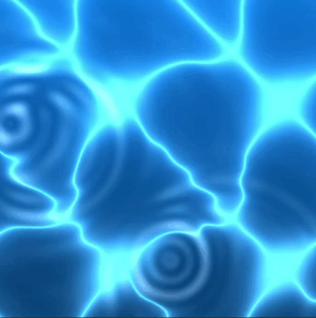
  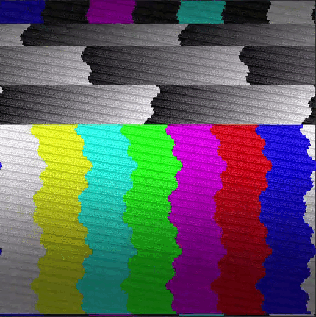
</p>

<p align="center">
  <em> Gotas de agua &nbsp;|&nbsp; Glitch, televisión antigua </em>
</p>


Dos shaders de fragmentos generativos y animados, escritos en GLSL para el editor de *The Book of Shaders* y reducidos a **512 bytes o menos** (*tiny code*): un estanque con **gotas de agua** que reacciona al ratón y una **televisión antigua con mala señal**. Como extra, los shaders salen del editor y se integran en el **Sistema Planetario** de la Práctica 6: la Tierra con día y noche, un Sol vivo, anillos, planetas procedurales en el modo creador y un efecto de impacto al chocar con la nave.

* **Editor de shaders:** [The Book of Shaders Editor](http://editor.thebookofshaders.com/)

---

## Contenidos

1. [Introducción y Enfoque](#introducción-y-enfoque)
2. [Shader 1: Gotas de Agua](#shader-1-gotas-de-agua)
    1. [Motivación](#motivación)
    2. [Desarrollo](#desarrollo)
    3. [Versión Extendida: Nenúfares y Ranita](#versión-extendida-nenúfares-y-ranita)
3. [Shader 2: Glitch](#shader-2-glitch)
    1. [Motivación](#motivación-1)
    2. [Desarrollo](#desarrollo-1)
4. [Extra: Shaders en el Sistema Planetario](#extra-shaders-en-el-sistema-planetario)
    1. [La Tierra: Día y Noche](#la-tierra-día-y-noche)
    2. [El Sol: Latido y Superficie de Lava](#el-sol-latido-y-superficie-de-lava)
    3. [Anillos de Saturno Procedurales](#anillos-de-saturno-procedurales)
    4. [Planetas Procedurales en el Modo Creador](#planetas-procedurales-en-el-modo-creador)
    5. [Efecto de Choque](#efecto-de-choque)
5. [Estructura del Repositorio](#estructura-del-repositorio)
6. [Fuentes](#fuentes)
7. [Nota: Uso de IA](#nota-uso-de-ia)

---

## Introducción y Enfoque

Un **shader de fragmentos** es un pequeño programa que se ejecuta en la GPU **una vez por cada píxel** de la pantalla, en paralelo. No dibuja formas ni guarda nada entre píxeles: solo recibe la posición del píxel (`gl_FragCoord`) y unos valores comunes a todos (*uniforms*) y devuelve su color (`gl_FragColor`). Toda la imagen sale de funciones matemáticas.

En el editor de *The Book of Shaders* se dispone de tres *uniforms*:

* **`u_resolution`:** tamaño del lienzo en píxeles.
* **`u_mouse`:** posición del ratón en píxeles.
* **`u_time`:** segundos desde que empezó el shader, que es lo que permite animar.

Para el *tiny code* cuentan todos los caracteres del fichero, por lo que las versiones mínimas se han escrito sin comentarios y con nombres de una letra, manteniendo los saltos de línea para que sigan siendo legibles.

> 💡 **Nota:** Los ficheros `_min.frag` se guardan con saltos de línea **LF** y sin línea vacía al final, ya que con saltos de línea de Windows (CRLF) cada salto ocupa 2 bytes. Por eso el repositorio incluye un `.gitattributes` con `*.frag text eol=lf`.

---

## Shader 1: Gotas de Agua

### Motivación

Igual que en la Práctica 6, donde incluí la constelación de Piscis, este shader vuelve a ser un detalle personal: **Piscis es mi signo del zodiaco**, un signo de agua, y siempre me ha gustado todo lo relacionado con el agua. Por eso quería un shader de agua con el que se pudiera interactuar.

El resultado es el fondo de una piscina o un estanque visto desde arriba: la luz forma la red de **cáusticas** típica del fondo, caen gotas que generan ondas y, al pasar el ratón, el agua se mueve bajo el cursor como si se metiera el dedo.

<p align="center">
  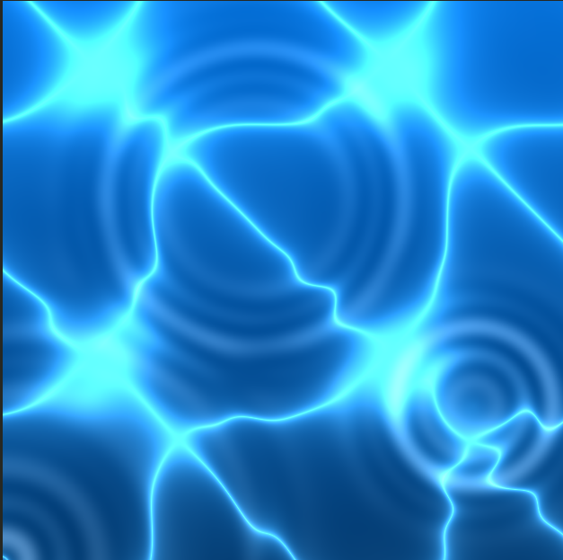
</p>

<p align="center">
  <em>Gotas de agua (versión mínima, 512 bytes)</em>
</p>


### Desarrollo

**1. Coordenadas normalizadas por la altura.** En lugar de dividir entre `u_resolution` (que deforma los círculos en una pantalla rectangular), se divide solo entre la altura. Así `y` va de 0 a 1 y las ondas salen siempre redondas.

**2. Gotas automáticas.** Un bucle crea 4 gotas. Cada una vive un ciclo: con `fract()` se obtiene su edad (0 al caer, 1 al desaparecer) y con `floor()` el número de ciclo, que sirve como semilla para que **cada vez caiga en un sitio distinto**. La posición se calcula con `fract(n * vec2(.61, .37))`, que da puntos repartidos por la pantalla sin necesidad de una función `random`, y que ocupa muchos menos bytes.

```glsl
for (float i = 0.; i < 4.; i++) {
    float ciclo = t * .3 + i * .25;          // cada gota desfasada 1/4 de ciclo
    float edad = fract(ciclo);               // 0 -> 1 durante su vida
    vec2 centro = fract((floor(ciclo) + i) * vec2(.61, .37)) * u_resolution / u_resolution.y;
    d = length(p - centro) - edad * .5;      // distancia al anillo que crece
    h += sin(d * 60.) * exp(-d * d * 99.) * (1. - edad);
}
```

* `length(p - centro) - edad * .5` es la distancia a un **anillo** cuyo radio crece con la edad: la onda se expande.
* `sin(d * 60.)` dibuja las crestas y los valles, `exp(-d*d*99.)` hace que solo se vean cerca del anillo y `(1. - edad)` las va apagando.

**3. La onda del ratón.** Es una onda continua centrada en `u_mouse`. Al restar el tiempo dentro del seno (`sin(d * 50. - t * 6.)`), los anillos **viajan hacia fuera**.

**4. Las cáusticas.** Son dos senos anidados que se cruzan; donde su suma vale casi cero aparecen líneas finas, y `.1 / (k + .1)` las convierte en luz brillante. La clave es que las coordenadas se **desplazan con la altura de las ondas** (`q = p * 12. + h * .3`), así que cuando pasa una gota la red de luz se deforma, igual que en una piscina real.

```glsl
vec2 q = p * 12. + h * .3;                                  // coordenadas deformadas por las ondas
float k = abs(sin(q.x + sin(q.y + t)) + sin(q.y + sin(q.x - t)));
col += .1 / (k + .1) * vec3(.4, .8, 1.);                   // red de luz de las cáusticas
```

**5. Color final.** Un azul que se aclara hacia arriba, más la luz de las cáusticas, más un brillo en las crestas de las ondas (`h * (.1 + h * .3)`).

* La versión mínima ocupa un tamaño justo de 512 bytes


### Versión Extendida: Nenúfares y Ranita

Sin límite de bytes, se ha ampliado el estanque con **tres nenúfares** y una **ranita** sentada en el más grande. El agua es exactamente la misma de la versión mínima, encapsulada en una función `agua(p)` para poder consultarla también en el centro de cada nenúfar.

<p align="center">
  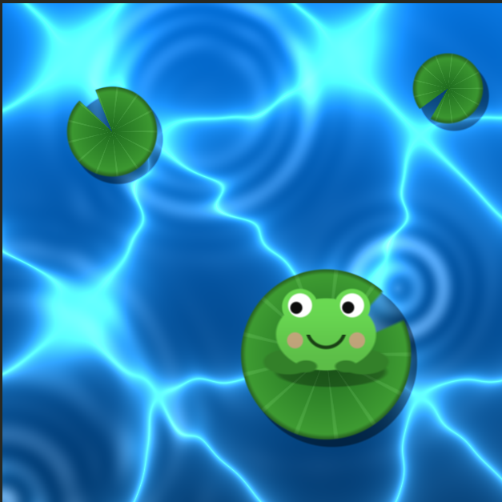
</p>

<p align="center">
  <em>Versión extendida: nenúfares y ranita</em>
</p>

Todas las figuras se dibujan con **funciones de distancia**, como en el laboratorio de formas de la S9: una función devuelve un valor negativo dentro de la forma y positivo fuera, y `smoothstep` la rellena con un borde suave de 1,5 píxeles.

```glsl
// Relleno suave a partir de una distancia con signo (negativa = dentro)
float relleno(float dist) {
    return smoothstep(e, -e, dist);
}

// Distancia aproximada a una elipse: se "estira" el espacio para que sea un círculo
float elipse(vec2 v, vec2 radio) {
    return (length(v / radio) - 1.) * min(radio.x, radio.y);
}
```

* **Nenúfares:** un círculo con una ranura calculada con el ángulo (`atan`), nervios radiales con `cos(ang * 13.)` y una sombra desplazada sobre el agua. Flotan a la deriva, se mecen y **se balancean cuando les llega una onda**, porque su posición suma `agua(centro)`.
* **Ranita:** construida por capas (sombra, patas traseras, cuerpo, patas delanteras, mofletes, sonrisa y ojos). El cuerpo es una elipse unida con dos círculos mediante `min()`, que es la **unión** de dos formas.
* **Ojos que siguen el ratón:** la pupila se desplaza en la dirección del cursor y la rana **parpadea** cada 4 segundos.

```glsl
float parpado = step(.96, fract(u_time * .25));               // 1 solo un instante cada 4 s
vec2 mira = normalize(raton - ojo + 1e-4) * .009;             // la pupila mira al ratón
col = mix(col, vec3(.05), relleno(length(p - ojo - mira) - .012) * (1. - parpado));
```

<p align="center">
  
</p>

<p align="center">
  <em>La ranita sigue el ratón con los ojos y parpadea</em>
</p>


---

## Shader 2: Glitch

### Motivación

Me gusta mucho el cine y la televisión, y estas barras de colores todos las tenemos asociadas a la tele: es la señal de prueba que se emitía cuando el transmisor estaba encendido pero no había programación.

Esta pantalla, entre otras, se usa muchísimo en los **dibujos animados** cuando algo sale mal; por ejemplo, en *Bob Esponja*. También es habitual verla en las **tomas falsas** (*bloopers*) de series y películas, como las de *Stranger Things*, donde la imagen se corta con barras de colores o con interferencias entre toma y toma. 

- Un ejemplo es [este vídeo de tomas falsas](https://www.youtube.com/watch?v=-6OFqkemd4c).

Evidentemente también, como estudiante de informática, me pareció interesante unir esa referencia con las pantallas: el shader reproduce una televisión de tubo con mala señal, en la que la imagen rueda, las líneas tiemblan y la pantalla se llena de nieve.

<p align="center">
  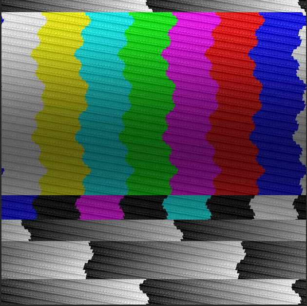
</p>

<p align="center">
  <em>Glitch: carta de ajuste de una televisión antigua</em>
</p>


### Desarrollo

**1. Las barras de colores con bits.** Tiene 7 barras (blanco, amarillo, cian, verde, magenta, rojo y azul). Numerándolas de 0 a 6, cada canal de color depende de **un bit del número**, así que se calculan los tres canales a la vez dividiendo entre `vec3(2, 4, 1)`:

```glsl
// 7 barras de colores: cada canal (R, G, B) sale de un bit del número de barra
vec3 barras(float x) {
    float n = floor(fract(x) * 7.);
    return mod(floor(n / vec3(2., 4., 1.)) + 1., 2.);
}
```

**2. Ajuste en tres zonas:** arriba, las barras; en medio, una franja estrecha con las barras **en orden inverso** (`barras(-x)`) alternando con negro, y abajo degradados de negro a blanco en 8 bandas desplazadas.

**3. Los efectos de tele antigua**, que imitan fallos reales de las teles de tubo:

* **La imagen rueda** (`fract(uv.y + t * .1)`): lo que sale por arriba vuelve a entrar por abajo, como cuando se perdía la sincronización vertical.
* **Zigzag y temblor:** la `x` se desplaza con una onda triangular `abs(fract(...) - .5)` que se mueve, y con un temblor distinto en cada una de las 90 líneas.
* **Nieve:** ruido con la función `random`, que cambia en cada fotograma porque el tiempo entra en la semilla.
* **Bandas oscuras** que suben por la pantalla, como la interferencia de la corriente eléctrica.

```glsl
float y = fract(uv.y + t * .1);                     // la imagen rueda
float linea = floor(y * 90.);                       // 90 líneas horizontales
float x = uv.x
        + .08 * abs(fract(y * 4. - t) - .5)         // zigzag grande que se mueve
        + .01 * sin(linea + t * 9.);                // temblor distinto en cada línea
...
col = col * .8 + random(uv + t) * .3;               // nieve
col *= .7 + .3 * sin(y * 6. - t);                   // bandas oscuras que suben
```

* La versión mínima ocupa un tamaño de 509 bytes.

<p align="center">
  
</p>

<p align="center">
  <em>Glitch (versión mínima, 509 bytes)</em>
</p>

A continuación, se muestra el enlace a YouTube haciendo referencia al mítico sonido que hace este efecto:
<p align="center">
  <a href="https://youtu.be/AkGtrSDxuTw"><em>Enlace al vídeo de demostración - glitch</em></a>
</p>

---

## Extra: Shaders en el Sistema Planetario

Como parte extra, los shaders se han integrado en el **Sistema Planetario Interactivo** de la [Práctica 6](../P6), sustituyendo algunos materiales de Three.js por `ShaderMaterial` propios. 

> Cada sección parte de los scripts proporcionados de ejemplo, adaptado a la escena.

**Enlace a CodeSandbox:** [Abrir en CodeSandbox](https://codesandbox.io/p/sandbox/github/albaquiintanaa/IG_PRACTICAS/tree/main/P8/extra)


### La Tierra: Día y Noche

La Tierra recibe dos texturas: la de día y una nueva **de noche con las luces de las ciudades**. El *vertex shader* calcula la normal de cada punto y el vector hacia el Sol (situado en el origen de la escena), y el *fragment shader* usa su **producto escalar** para decidir qué textura mostrar:

```glsl
// Producto escalar normal-luz: > 0 mira al Sol, < 0 está de noche
float LdotN = dot(v_Luz, v_Normal);
float Id = min(1.0, abs(LdotN)); // Lambert

if (LdotN > 0.0) {
  gl_FragColor = vec4(texture2D(texture1, vUv).rgb * Id, 1.0);   // día
} else {
  gl_FragColor = vec4(texture2D(texture2, vUv).rgb * Id, 1.0);   // noche
}
```

Al girar y orbitar la Tierra, la frontera entre el día y la noche se mueve sola. Las nubes (`EsferaHija`) siguen encima.

| Antes | Después |
| :---: | :---: |
| 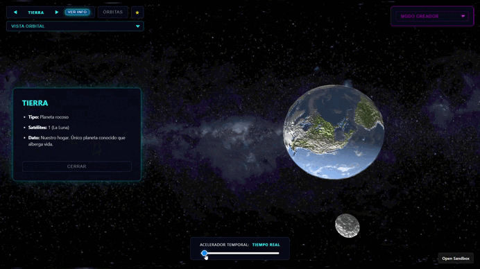 | 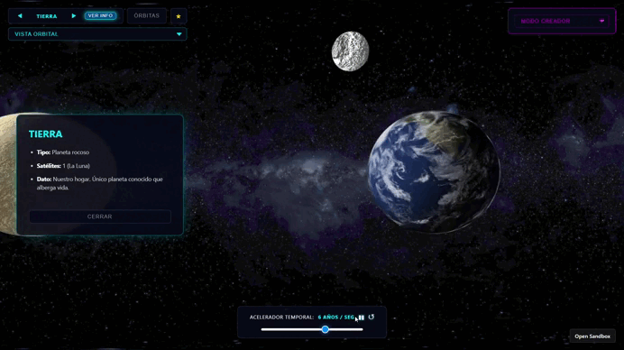 |


### El Sol: Latido y Superficie de Lava

El Sol pasa de un `MeshBasicMaterial` a un `ShaderMaterial` combinando tres aspectos:

* **Latido** (*vertex shader*, `vertexShader4`): la posición de cada vértice se escala con `1 + sin(u_time * 2) * 0.02`, así que el Sol crece y encoge suavemente.
* **Textura que gira**: la coordenada de la textura se desplaza con el tiempo.
* **Superficie que hierve** (`random` y `vnoise`): el ruido se usa para cambiar el brillo y, además, para **deformar la textura**, de forma que la superficie parece fluir como lava.

```glsl
vec3 p = vPos * 0.8;
// Ruido 2D en los tres planos de la esfera (xy, yz, zx) para que no haya costuras
float n = (vnoise(p.xy + u_time * 0.5)
         + vnoise(p.yz - u_time * 0.4)
         + vnoise(p.zx + u_time * 0.45)) / 3.0;

// La textura se desplaza (giro) y se deforma con el ruido
vec2 st = vUv;
st.x += u_time * 0.01;
st += (n - 0.5) * 0.06;
vec3 color = texture2D(texture1, st).rgb;

// Zonas frías más rojas y oscuras, zonas calientes más brillantes
color = mix(color * vec3(0.9, 0.45, 0.2), color * 1.5, smoothstep(0.35, 0.65, n));
```

> 💡 **Nota:** El ruido se aplica en los tres planos de la esfera y se promedia. Además, al desplazar la textura la coordenada supera 1, y por defecto Three.js estira el último píxel del borde (aparecían anillos que crecían con cada vuelta). Se soluciona indicando que la textura se repita: `texture.wrapS = THREE.RepeatWrapping`.

| Antes | Después |
| :---: | :---: |
| 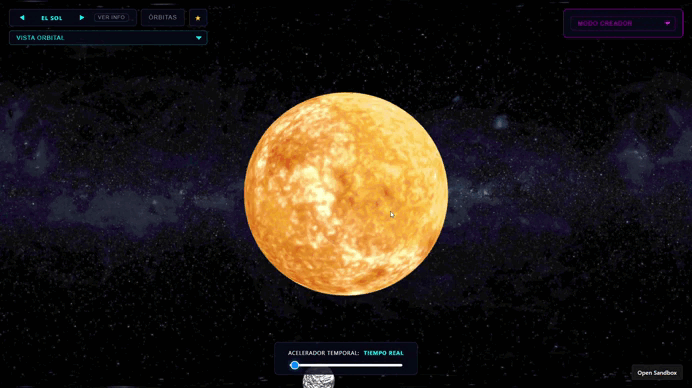 | 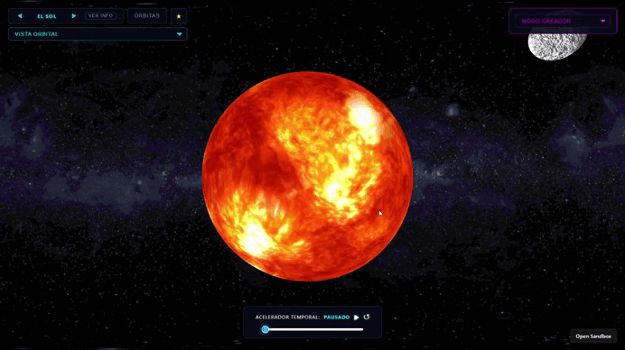 |


### Anillos de Saturno Procedurales

Los anillos ya no usan la imagen `saturn_ring.png`: se **generan con código** usando el ruido 1D (`hash` y `noise`). La función `Anillo()` ya recalculaba las coordenadas UV según el radio, así que `vUv.x` va de 0 (borde interior) a 1 (borde exterior), justo lo que necesita el shader:

```glsl
float r = vUv.x; // 0 = borde interior, 1 = borde exterior

// Densidad: bandas anchas + cientos de anillos finos
float densidad = 0.3 + 0.4 * noise(r * 25.0) + 0.3 * noise(r * 200.0);

// Huecos: división de Cassini (ancha) y división de Encke (fina)
densidad *= smoothstep(0.03, 0.05, abs(r - 0.62));
densidad *= smoothstep(0.005, 0.012, abs(r - 0.9));
...
gl_FragColor = vec4(color, densidad * 0.9);   // la densidad es la transparencia
```

Además, un ruido que avanza con el tiempo hace **centellear** el hielo de los anillos.

| Antes - textura | Después - shader |
| :---: | :---: |
| 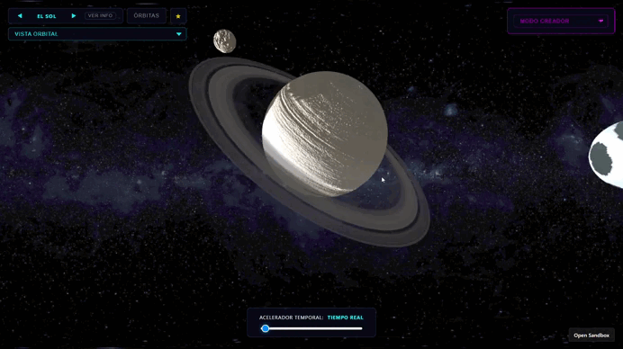 | 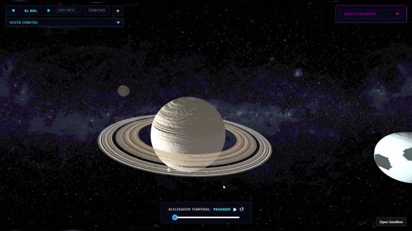 |


### Planetas Procedurales en el Modo Creador

Los planetas creados por el usuario en la parte de `TransformControls`, eran esferas que solo cambiaban de color plano según su distancia al Sol. Ahora cada planeta es **único y se genera por completo en la GPU**:

* **Semilla aleatoria** (`uSeed = Math.random() * 100`): dos planetas nunca son iguales.
* **Relieve real** (*vertex shader*): cada vértice se desplaza a lo largo de su normal según la altura del ruido. Por debajo del nivel del mar no se desplaza, así que el mar queda liso, igual que en el ejemplo del profesor (que lo hace sobre un plano).
* **Aspecto según la zona** (*fragment shader*): el motor climático anterior ya no cambia el color de la malla, sino el *uniform* `uZona`:
    * **Abrasador:** lagos de **lava** que brillan y laten (también en la cara de noche) y roca volcánica.
    * **Templado:** océanos, playas, bosques, montañas y nieve, con colores topográficos.
    * **Helado:** mares congelados y montañas de hielo.

```glsl
void main() {
  vec3 p = normalize(position) * 2.0;
  // Ruido en los tres planos de la esfera para evitar costuras
  float h = (rnd(p.xy) + rnd(p.yz + 7.0) + rnd(p.zx + 13.0)) / 3.0;
  vH = h;

  // Relieve: por debajo del nivel del mar no se desplaza
  vec3 newPosition = position + normal * (max(h, uSea) - uSea) * uNoiseAmp * 3.0;
  ...
}
```

```javascript
// En main.js, el modo creador solo tiene que avisar al shader de la zona
astro.material.uniforms.uZona.value = zona;   // el shader cambia lava / mar / hielo
```

| | Abrasador | Templado | Helado |
| :---: | :---: | :---: | :---: |
| **Antes** | 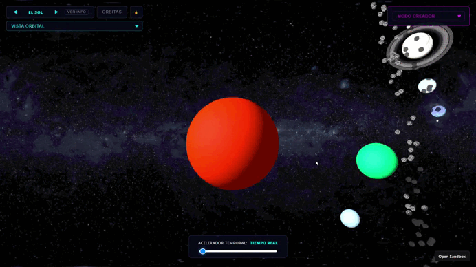 | 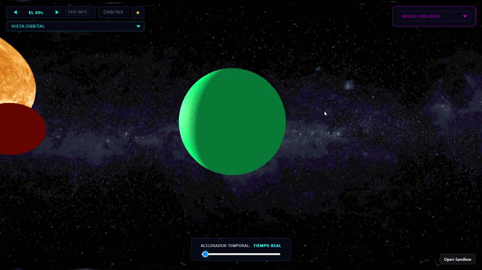 | 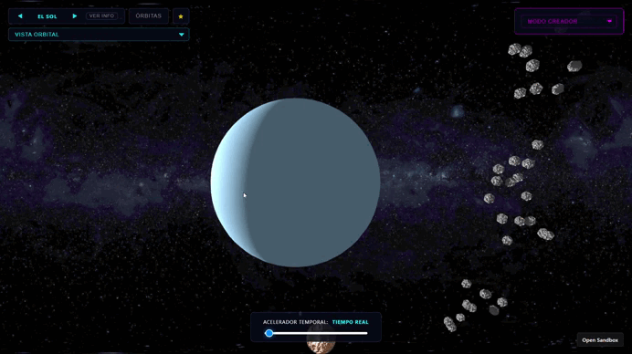 |
| **Después** | 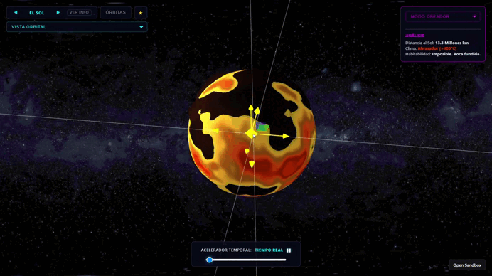 | 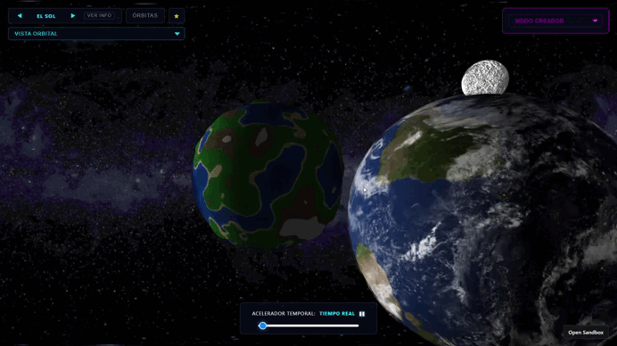 | 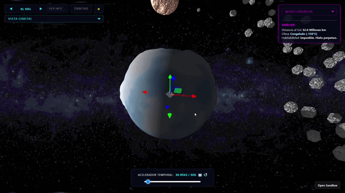 |


### Efecto de Choque

Cuando la nave choca con un planeta o una luna, la pantalla recibe el impacto: **destello blanco, la cámara tiembla, una onda expansiva sale del centro y deforma la imagen** al pasar -la misma idea que las ondas de las gotas-, los colores se separan y los bordes se tiñen de rojo, mientras aparece el aviso **⚠ CUIDADO ⚠**.

| Antes | Después |
| :---: | :---: |
| 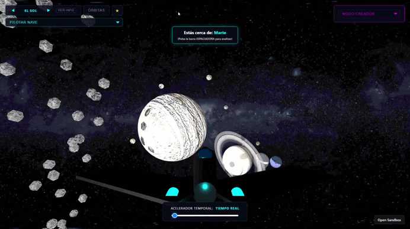 | 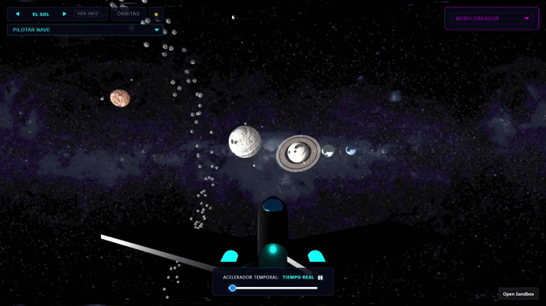 |

Un shader de fragmentos no puede deformar algo que ya está dibujado, así que el efecto se hace en dos pasos:

1. La escena se dibuja en una **textura** (`WebGLRenderTarget`) en vez de en la pantalla.
2. Esa textura se pinta en un **plano que cubre toda la pantalla** con un `ShaderMaterial` que la deforma.

```javascript
// Escena -> textura
renderer.setRenderTarget(rtChoque);
renderer.render(scene, camara);
// Textura deformada por el shader -> pantalla
renderer.setRenderTarget(null);
renderer.render(escenaChoque, camaraChoque);
```

Todo el efecto se multiplica por la fuerza del impacto `k`, que vale 1 al chocar y baja a 0 en 0,7 segundos. Cuando no hay choque, la escena se dibuja directamente, sin el paso extra.

```glsl
// Onda expansiva: un anillo que crece desde el centro
float radio = p * 1.2;
float onda = d - radio;
float anillo = exp(-onda * onda * 800.0);
uv += dir / vec2(u_aspecto, 1.0) * anillo * 0.06 * k;   // empuja la imagen hacia fuera
```

---

## Estructura del Repositorio

```
P8/
├── README.md
├── .gitattributes
├── shaders/
│   ├── gotas/
│   │   ├── gotas_min.frag  ← 512 bytes
│   │   └── gotas_ranita.frag ← versión extendida
│   └── glitch/
│       ├── glitch_min.frag ← 509 bytes
│       └── glitch.frag     ← versión legible y comentada
├── extra/
│   └── src/
└── docs/
```

El código del extra se ha modularizado separando la lógica de los shaders:

* **`objects.js`:** crea los astros (`Estrella`, `Planeta`, `PlanetaDiaNoche`, `MaterialPlanetaProcedural`, `Anillo`…) y define el tiempo compartido `uTiempo`.
* **`shaders.js`:** todos los *vertex* y *fragment shaders* de la práctica.
* **`choque.js`:** lógica del efecto de impacto (render a textura y activación).


---

## Fuentes

* **Repositorio de la asignatura (S9):** [otsedom/IG/S9](https://github.com/otsedom/otsedom.github.io/tree/main/IG/S9), con los scripts de ejemplo utilizados: `script_35_shader_texturas.js`, `script_36_shader_dobletextura.js`, `script_37_shader_filtros.js`, `script_39_shadervertices.js` y `script_40_shadervertices_color.js`.
* **The Book of Shaders** (Patricio Gonzalez Vivo y Jen Lowe): [https://thebookofshaders.com/](https://thebookofshaders.com/), en especial los capítulos de [formas](https://thebookofshaders.com/07/?lan=es), [patrones](https://thebookofshaders.com/09/?lan=es), [aleatorio](https://thebookofshaders.com/10/?lan=es) y [ruido](https://thebookofshaders.com/11/?lan=es).
* **Editor de The Book of Shaders:** [http://editor.thebookofshaders.com/](http://editor.thebookofshaders.com/)
* **Documentación Oficial Three.js:** [`ShaderMaterial`](https://threejs.org/docs/#api/en/materials/ShaderMaterial), [`WebGLRenderTarget`](https://threejs.org/docs/#api/en/renderers/WebGLRenderTarget), [`Texture.wrapS`](https://threejs.org/docs/#api/en/textures/Texture.wrapS).
* **Solar System Scope (Textura de la Tierra de noche):** [https://www.solarsystemscope.com/textures/](https://www.solarsystemscope.com/textures/)

---

## Nota: Uso de IA

Durante el desarrollo de esta práctica, se ha empleado Inteligencia Artificial [Claude](https://claude.ai) como herramienta de asistencia técnica, **bajo revisión activa**:

1. **Revisión del código:** Comprobación del tamaño de las versiones mínimas (512 bytes como máximo, saltos de línea LF y sin línea vacía al final), propuestas para reducir bytes y detección de errores en la integración con el sistema planetario.
2. **Sonido del vídeo:** Generación por código del sonido de tele rota que acompaña al shader de glitch en el vídeo de YouTube.
3. **Documentación del README:** Organización estructural, indexación temática y presentación en formato Markdown de la memoria descriptiva de la práctica.

---