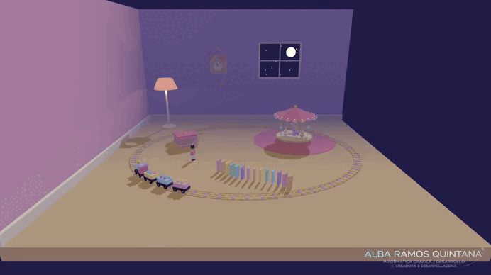
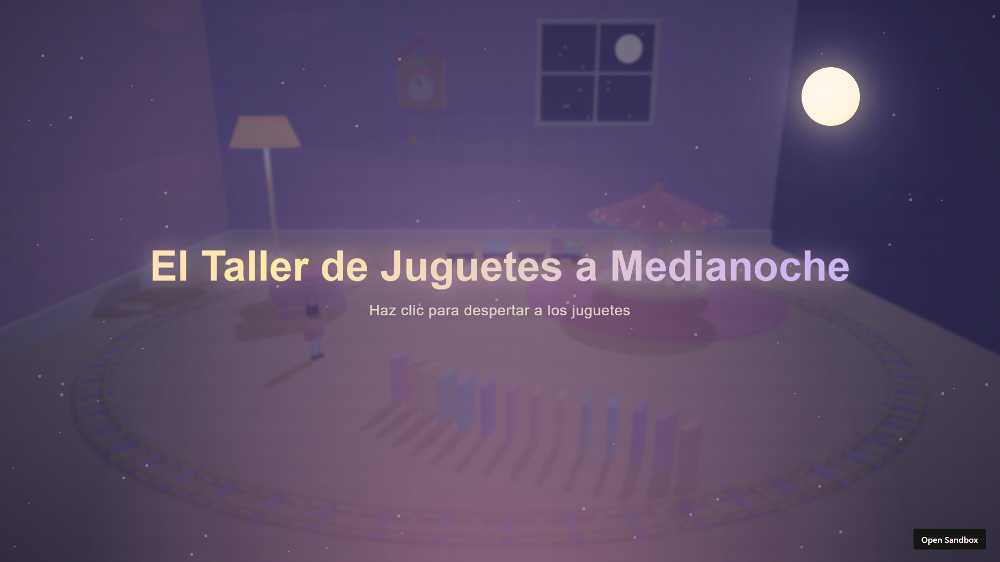
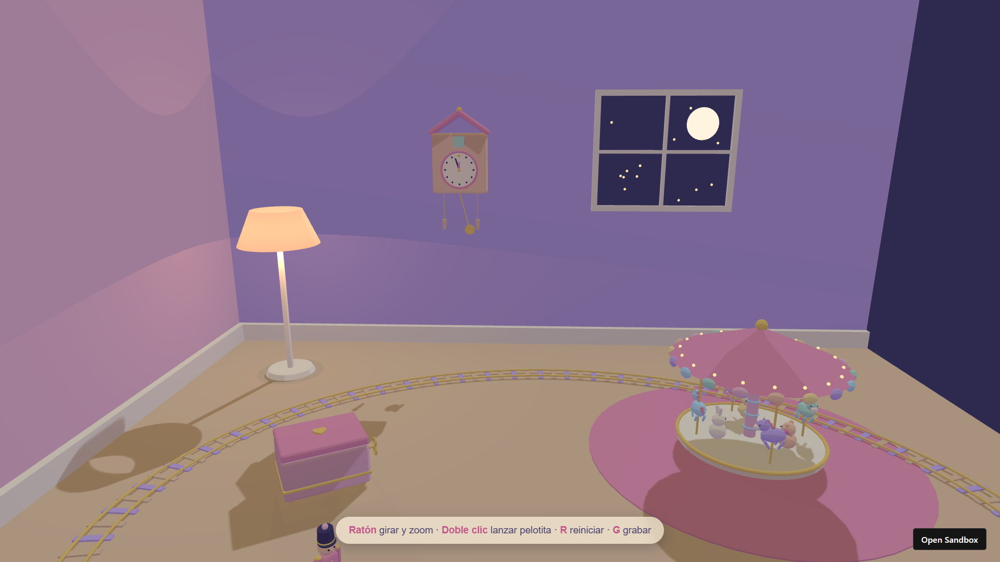
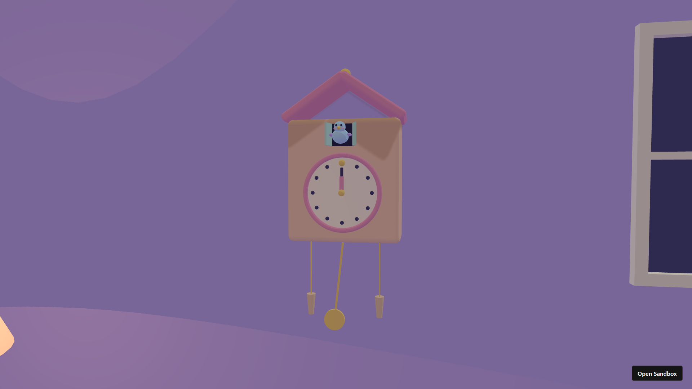
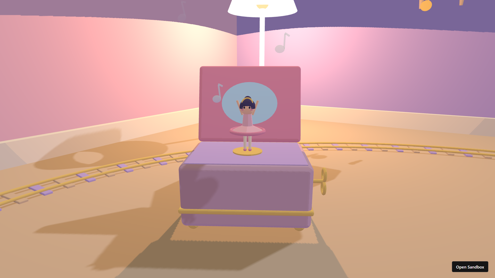
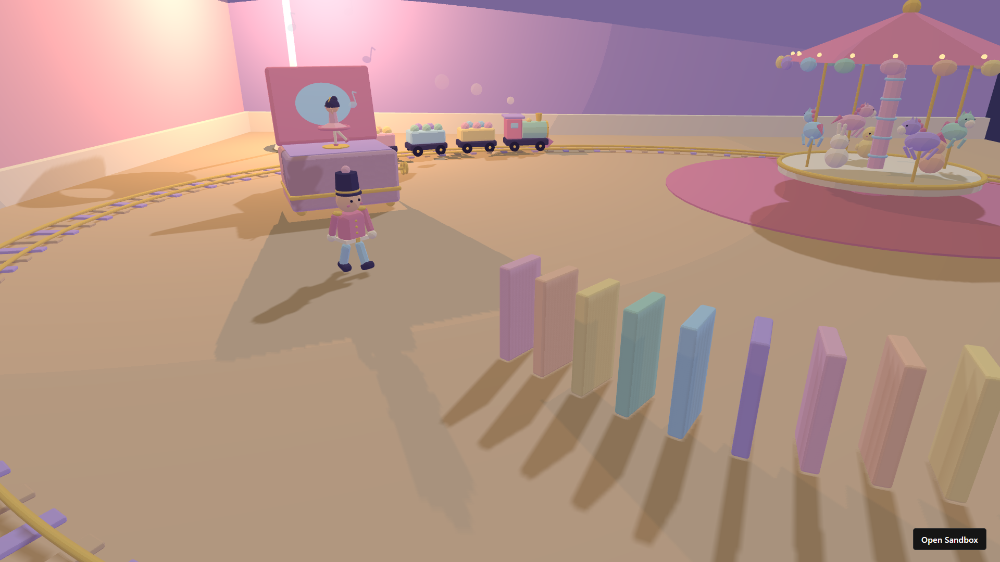
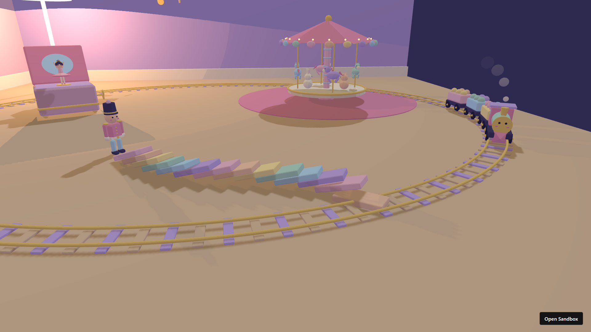
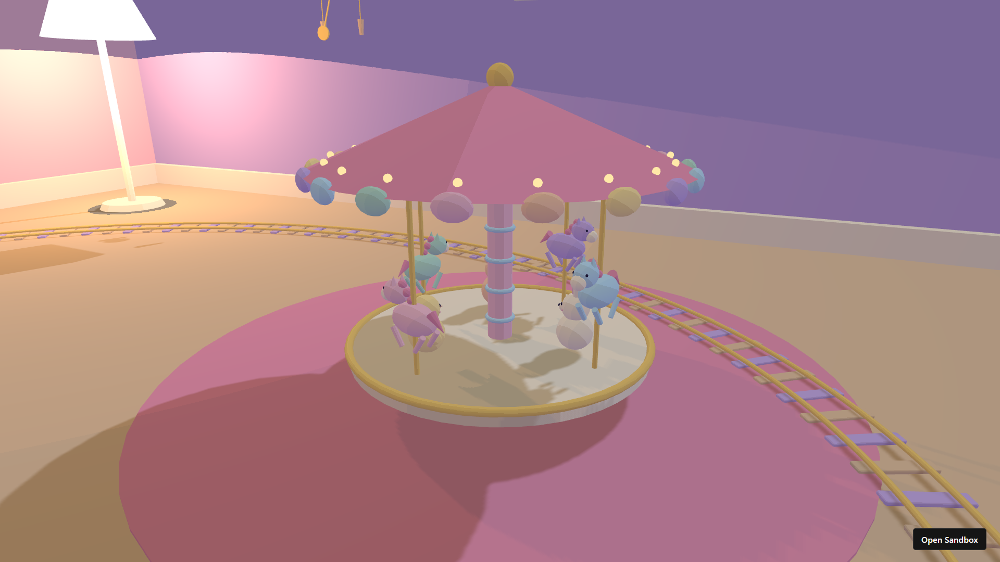
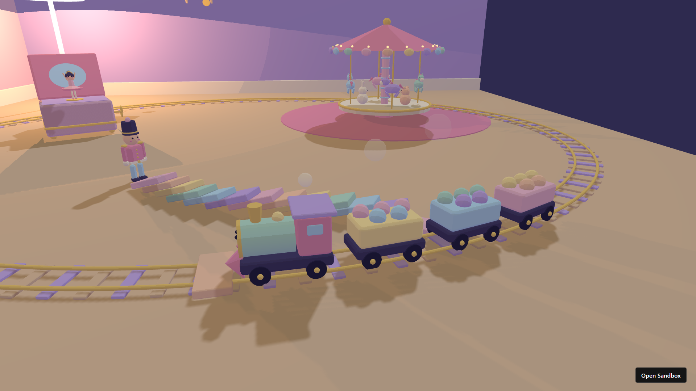
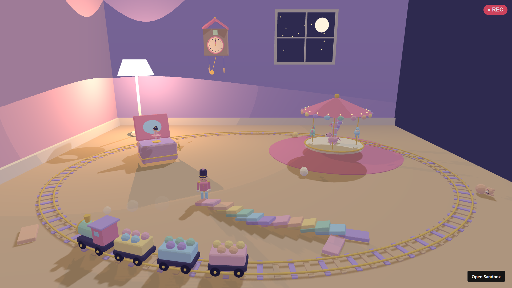

# Práctica 9 - El Taller de Juguetes a Medianoche

## [Alba Ramos Quintana](https://github.com/albaquiintanaa)

<p align="center">
  
</p>

<p align="center">
  <a href="https://youtu.be/QadTyxuCawo"><em>Enlace al vídeo de demostración de la aplicación</em></a>
</p>

Al dar la medianoche, los juguetes de un pequeño taller cobran vida: el **reloj de cuco** anuncia la hora, la **caja de música** se abre y su bailarina baila, un **soldadito** saluda, desfila y derriba una fila de **fichas de dominó**, la última cae sobre la vía y el **tren** de juguete la aparta al pasar y, para terminar, el **tiovivo** gira al son de una música de feria hasta que los peluches salen volando. 

Un prototipo en Three.js que combina **animación con tween.js** y **simulación física con ammo.js**.

**Enlace a CodeSandbox:** [Abrir en CodeSandbox](https://codesandbox.io/p/sandbox/github/albaquiintanaa/IG_PRACTICAS/tree/main/P9)

---

## Contenidos

1. [Introducción y Enfoque](#introducción-y-enfoque)
2. [La Historia y la Interacción](#la-historia-y-la-interacción)
3. [Parte Tween: Animación](#parte-tween-animación)
    1. [Reloj de Cuco](#reloj-de-cuco)
    2. [Caja de Música y Bailarina](#caja-de-música-y-bailarina)
    3. [Soldadito](#soldadito)
    4. [Cámara y Decorado](#cámara-y-decorado)
4. [Parte Ammo: Física](#parte-ammo-física)
    1. [Mundo Físico y Tipos de Cuerpos](#mundo-físico-y-tipos-de-cuerpos)
    2. [Fichas de Dominó](#fichas-de-dominó)
    3. [Tiovivo: Bisagra con Motor](#tiovivo-bisagra-con-motor)
5. [Tween + Ammo: Cómo se Combinan](#tween--ammo-cómo-se-combinan)
    1. [El Tren](#el-tren)
6. [Sonido y Grabación](#sonido-y-grabación)
7. [Arquitectura del Código](#arquitectura-del-código)
8. [Fuentes](#fuentes)
9. [Nota: Uso de IA](#nota-uso-de-ia)

---

## Introducción y Enfoque

Me encanta Disney, y una de las ideas que más me ha gustado siempre es la de *Toy Story*: en cuanto Andy sale de la habitación, los juguetes cobran vida, y en cuanto vuelve, se quedan quietos. Este taller es un pequeño homenaje a esa idea: es medianoche, no hay nadie mirando, y los juguetes aprovechan para jugar. 

Para darles vida a estos juguetes se combinan dos aspectos:

* **tween.js** interpola valores entre un inicio y un final con una curva de suavizado (*easing*). El resultado es siempre el mismo y lo decido yo: es ideal para coreografías, movimientos de cámara y piezas articuladas.
* **ammo.js** simula la física: gravedad, choques y restricciones. El movimiento no se programa, **sale de la simulación**, así que cada ejecución es un poco distinta.

Encajan muy bien con la historia: lo que los juguetes hacen "por voluntad propia" (cantar, bailar, saludar, desfilar) se anima con tween, y lo que pasa como consecuencia (lo que cae, choca o sale volando) lo resuelve la física.

---

## La Historia y la Interacción

La aplicación comienza con una pantalla de inicio; al hacer clic se activa el audio y arranca la historia, mientras un *Toast* muestra durante unos segundos los controles disponibles.

| Pantalla de inicio | Toast de controles |
| :---: | :---: |
|  |  |

La historia se desarrolla como una secuencia de escenas encadenadas, en la que la cámara se desplaza de un juguete a otro:

1. **Reloj de cuco:** marca la medianoche y el pájaro sale a cantar.
2. **Caja de música:** se abre y la bailarina comienza a bailar.
3. **Soldadito y dominó:** el soldadito saluda, desfila y empuja la primera ficha, que derriba al resto en cadena.
4. **Tren:** la última ficha cae sobre la vía y el tren la aparta a su paso.
5. **Tiovivo:** gira al ritmo de la música hasta que los peluches salen disparados.
6. **Final:** todos los juguetes continúan en movimiento con música de fondo y la cámara queda libre para explorar la escena.

| Control | Acción |
| :---: | --- |
| Clic en la pantalla inicial | Iniciar la historia |
| Arrastrar / rueda | Rotar y hacer zoom (`OrbitControls`) |
| Doble clic | Lanzar una pelota |
| **R** | Reiniciar la historia |
| **G** | Iniciar / detener la grabación de vídeo |

---

## Parte Tween: Animación

Todos los tweens pertenecen a un **grupo propio** (`TWEEN.Group`) en lugar del grupo global. Así, al pulsar **R** se pueden reiniciar todas las animaciones.

Las piezas que giran se construyen como el brazo articulado de los ejemplos del material de la práctica: cada pieza cuelga de un `Object3D` que hace de **pivote**, colocado justo en su eje de giro (una bisagra, un hombro, una cadera). Al girar el pivote, la pieza gira alrededor de ese punto y no de su centro.

### Reloj de Cuco

<p align="center">
  
</p>

* **Agujas:** cada una cuelga de un pivote en el centro de la esfera. Un tween por minuto, encadenados con `chain()`, avanza de las 11:57 a las 12:00 con un pequeño rebote (`Back.Out`) y un *tic-tac* en cada salto.
* **Puertas y pájaro:** las puertas giran sobre sus bisagras y el pájaro sale como un muelle (`Elastic.Out`). Cada *cu-cú* es un movimiento que va y vuelve con `yoyo`.
* **Péndulo:** oscila sin parar desde que se carga la página con `yoyo(true)` y `repeat(Infinity)`.

Toda la secuencia es una lista de tweens que se encadenan uno detrás de otro:

```javascript
// tic -> tic -> tic -> abrir puertas -> salir -> cucú x3 -> entrar -> cerrar
const secuencia = [...tics, abrir, salir, ...cucus, entrar, cerrar];
for (let i = 0; i < secuencia.length - 1; i++) secuencia[i].chain(secuencia[i + 1]);
secuencia[0].start();
```

> 💡 **Nota:** En tween.js, si no se indica `repeatDelay`, el `delay` del tween también se aplica entre las repeticiones. Por eso los *cu-cú* llevan `repeatDelay(0)`; si no, el pájaro se quedaba parado a mitad del movimiento.

### Caja de Música y Bailarina

<p align="center">
  
</p>

* La **llave de cuerda** da dos vueltas, la **tapa** se abre girando sobre su bisagra trasera y la **bailarina** sube como un resorte con los brazos hacia arriba.
* Un segundo después empieza la música y salen **notas musicales** de colores que suben, se balancean y se desvanecen (cada una con su propio material para poder bajar su opacidad).
* **El baile** combina varios tweens infinitos: el giro, los brazos que suben y bajan y la pierna, estos dos últimos con `yoyo`. Cuando caen las fichas, termina la vuelta mirando al frente y se queda quieta en su pose.
* El corazón dorado de la tapa es una forma 2D (`THREE.Shape` con curvas de Bézier) extruida con `ExtrudeGeometry`.

### Soldadito

<p align="center">
  
</p>

Tiene pivotes en las caderas y los hombros. Su secuencia es: se gira hacia la cámara, **saluda**, vuelve a su rumbo, **desfila**, se pone firme y **empuja** la primera ficha.

Para desfilar, un único tween hace avanzar una "fase" y, a partir de ella, se calculan a la vez las piernas, los brazos (en sentido contrario) y un pequeño bote del cuerpo en cada paso:

```javascript
const s = Math.sin(fase.f);
piernaIzq.rotation.x = 0.55 * s;
piernaDer.rotation.x = -0.55 * s;
brazoIzq.rotation.x = -0.6 * s;
cuerpo.position.y = 0.04 * Math.abs(Math.cos(fase.f));
```

### Cámara y Decorado

* **Cámara:** una función `moverCamara()` crea un tween que interpola a la vez la posición de la cámara y el punto al que mira, así la cámara viaja de un juguete a otro como en una película.
* **Lámpara:** empieza casi apagada y se enciende con un tween de su intensidad cuando el cuco da la hora.
* **Humo del tren y notas:** pequeñas esferas que crecen, suben y se desvanecen.

---

## Parte Ammo: Física

### Mundo Físico y Tipos de Cuerpos

El mundo físico se crea igual que en el material proporcionado (`btDiscreteDynamicsWorld` con gravedad), y en cada fotograma se avanza la simulación y se copia la posición de cada cuerpo a su malla. Se usan **tres tipos de cuerpos**:

| Tipo | Quién lo mueve | Ejemplos |
| --- | --- | --- |
| **Estático** (masa 0) | Nadie, no se mueve | Suelo, paredes, casa del reloj, base de la caja, columna del tiovivo |
| **Dinámico** (masa > 0) | La física | Fichas de dominó, peluches, disco del tiovivo, pelotitas |
| **Cinemático** | Tween o el código | Péndulo, tapa de la caja, guante del soldadito, vagones del tren |

Los cuerpos **cinemáticos** son la pieza clave de la práctica: no los mueve la física, pero la física sí los tiene en cuenta, así que **empujan** a los dinámicos. En cada fotograma se copia su posición (la que ha puesto tween) al mundo físico:

```javascript
// Antes de avanzar la simulación: la física "se entera" de dónde los ha puesto tween
mesh.getWorldPosition(_pos);
mesh.getWorldQuaternion(_quat);
// ... se guardan en una transformación de ammo ...
cuerpo.getMotionState().setWorldTransform(tmpTrans);
```

Además, con doble clic se lanzan **pelotitas** (con el *raycaster* del ejemplo proporcionado en el material de la práctica) que rebotan en las paredes, el reloj, la caja y el tren, y que el péndulo golpea al pasar.

### Fichas de Dominó

<p align="center">
  
</p>

Las fichas siguen una **curva** (`CatmullRomCurve3`). Con `getPointAt()` se reparten a la misma distancia unas de otras y con `getTangentAt()` cada una se gira según la dirección de la curva. Al final la fila gira hacia la vía, para que la última ficha caiga justo sobre los raíles. 

> La separación es la mitad de su altura, para que la cadena no se corte.

### Tiovivo: Bisagra con Motor

<p align="center">
  
</p>

Es la parte más física de la práctica:

* **Columna:** cuerpo estático en el centro de la alfombra.
* **Disco:** cuerpo dinámico unido a la columna con una **bisagra** (`btHingeConstraint`) de eje vertical, que solo le deja girar sobre sí mismo. La bisagra tiene un **motor** (`enableAngularMotor`) que lo hace girar.
* **Peluches**: cuerpos dinámicos sentados sobre el disco. Giran con él gracias a la fricción y, cuando el tiovivo va demasiado rápido, resbalan y **salen volando** dando volteretas.

```javascript
// Bisagra vertical entre la parte de arriba de la columna y la de abajo del disco
bisagra = new A.btHingeConstraint(
  columna.userData.cuerpoFisico, disco.userData.cuerpoFisico,
  pivoteA, pivoteB, eje, eje, true
);
fisica.getMundo().addConstraint(bisagra, true); // true: columna y disco no chocan entre sí
```

> 💡 **Nota:** Los peluches usan una caja de colisión y no una esfera: una esfera rodaba sobre el disco en lugar de ir "sentada".

---

## Tween + Ammo: Cómo se Combinan

Si tween y ammo mueven el mismo objeto a la vez, se pelean y el objeto tiembla. Por eso la combinación sigue cuatro patrones:

1. **Tween dirige y la física reacciona:** el objeto animado es un cuerpo cinemático que empuja a los dinámicos (el guante del soldadito tira la primera ficha, el péndulo golpea las pelotas, el tren aparta la ficha).
2. **Tween dispara eventos físicos:** al terminar un tween empieza lo siguiente (el empujón del soldadito desencadena la caída del dominó).
3. **Cada uno es independiente:** tween mueve la cámara, las luces y el decorado; ammo, los objetos que chocan.
4. **Tween anima parámetros físicos:** en el tiovivo, tween no mueve el disco, sino **la velocidad de su motor** (arranca, pasea, se embala y frena), y en el tren anima su velocidad.

### El Tren

<p align="center">
  
</p>

La **vía** es una curva cerrada con forma de elipse que rodea toda la habitación (raíles con `TubeGeometry` y traviesas orientadas según la curva). El tren **circula siempre**, desde que se carga la página: en cada fotograma avanza según su velocidad y cada vagón se coloca en la curva y se orienta con su tangente. 

- Los vagones son cuerpos cinemáticos.

Cuando el soldadito empuja la primera ficha, el tren calcula a qué distancia está del punto donde caerá la última y **ajusta su velocidad con un tween** para llegar justo cuando ya está tumbada sobre la vía. 

> Un segundo antes suena el *chu-chú*.

```javascript
// Distancia recorrida en cada fotograma: velocidad · tiempo (la velocidad la anima tween)
const paso = tren.v * dt;
tren.s = (tren.s + paso) % largoVia;
```

---

## Sonido y Grabación

* **Sonido:** cada juguete carga sus mp3 con `THREE.Audio` y `AudioLoader`. Todos pasan por el `AudioListener` de la cámara.
* **Grabación (tecla G):** se graba el canvas con `MediaRecorder`. El audio de Three.js también se incluye en el vídeo, conectándolo a un `MediaStreamAudioDestinationNode`.

<p align="center">
  
</p>

---

## Arquitectura del Código

```
P9/
├── README.md
├── package.json
├── docs/
└── src/
    ├── index.html
    ├── styles.css
    ├── main.js
    ├── fisica.js
    ├── animacion.js
    ├── sonido.js
    ├── grabacion.js
    ├── escena.js
    ├── paleta.js
    ├── juguetes/
    │   ├── reloj.js
    │   ├── caja.js
    │   ├── soldadito.js
    │   ├── dominos.js
    │   ├── tren.js
    │   └── tiovivo.js
    └── sounds/
```

* **`main.js`:** inicia la aplicación, gestiona los eventos, encadena la historia (una función por escena) y mantiene el bucle: primero tween mueve las cosas, luego avanza el tren, después la física reacciona y por último se dibuja.
* **`fisica.js`:** mundo de ammo.js y creación de cuerpos estáticos, dinámicos y cinemáticos.
* **`animacion.js`:** grupo de tweens propio y función `tween()`.
* **`sonido.js`:** carga y reproducción de los mp3.
* **`grabacion.js`:** grabación del canvas con audio.
* **`escena.js` y `paleta.js`:** habitación, luces, colores y materiales.
* **`juguetes/`:** un fichero por juguete, cada uno con su construcción, su animación y su función `reiniciar()`.

---

## Fuentes

**Repositorio de la asignatura (S11):** [otsedom/IG/S11](https://github.com/otsedom/otsedom.github.io/tree/main/IG/S11), con los scripts de ejemplo utilizados:

* [`script_41_tween.js`](https://github.com/otsedom/otsedom.github.io/blob/main/IG/S11/code/script_41_tween.js): uso básico de tween (`to`, `easing`, `delay`, `onUpdate`, `chain`).
* [`script_43_tween_record.js`](https://github.com/otsedom/otsedom.github.io/blob/main/IG/S11/code/script_43_tween_record.js): grabación con `captureStream` y `MediaRecorder`.
* [`script_44_tween_record_audio.js`](https://github.com/otsedom/otsedom.github.io/blob/main/IG/S11/code/script_44_tween_record_audio.js): `AudioListener`, `THREE.Audio` y `AudioLoader`, y arranque del audio con un clic.
* [`script_45_ammo.js`](https://github.com/otsedom/otsedom.github.io/blob/main/IG/S11/code/script_45_ammo.js): inicialización de ammo, mundo físico, cuerpos rígidos, actualización de la física, suelo estático, muro de bloques y lanzamiento con raycaster.
* [`script_46_articulada.js`](https://github.com/otsedom/otsedom.github.io/blob/main/IG/S11/code/script_46_articulada.js): piezas articuladas con pivotes `Object3D` y tweens encadenados.

**Física (ammo.js):**

* **Cuerpos cinemáticos:** [BlueMagnificent – Moving Objects in JavaScript 3D Physics using Ammo.js and Three.js](https://medium.com/@bluemagnificent/moving-objects-in-javascript-3d-physics-using-ammo-js-and-three-js-6e39eff6d9e5) y su [gist](https://gist.github.com/BlueMagnificent/9d2bbc0cea7ddb9a486291b71f422a55); [aframe-physics-system – AmmoDriver](https://github.com/kylebakerio/aframe-physics-system/blob/master/AmmoDriver.md) (tipos de cuerpos).
* **Bisagra con motor:** ejemplo oficial de Three.js [`physics_ammo_cloth`](https://github.com/mrdoob/three.js/blob/r152/examples/physics_ammo_cloth.html) y la interfaz de ammo.js [`ammo.idl`](https://github.com/kripken/ammo.js/blob/main/ammo.idl).

**Animación (tween.js):**

* [tween.js – User Guide](https://github.com/tweenjs/tween.js/blob/main/docs/user_guide.md): `Group` propio, `yoyo`, `repeat(Infinity)`, `repeatDelay` y tweens hacia listas de valores.

**Documentación Oficial Three.js:**

* [`RoundedBoxGeometry`](https://threejs.org/docs/pages/RoundedBoxGeometry.html), [`Curve`](https://threejs.org/docs/pages/Curve.html) (`getPointAt`, `getTangentAt`), [`TubeGeometry`](https://threejs.org/docs/pages/TubeGeometry.html).
* Ejemplos: [`webgl_materials_toon`](https://github.com/mrdoob/three.js/blob/dev/examples/webgl_materials_toon.html) (mapa de degradado de los materiales toon) y [`webgl_geometry_shapes`](https://github.com/mrdoob/three.js/blob/r152/examples/webgl_geometry_shapes.html) (`Shape` + `ExtrudeGeometry` para el corazón).

**Audio y grabación (MDN):**

* [`AudioContext.createMediaStreamDestination()`](https://developer.mozilla.org/en-US/docs/Web/API/AudioContext/createMediaStreamDestination) y [MediaStream Recording API](https://developer.mozilla.org/en-US/docs/Web/API/MediaStream_Recording_API).

**Sonidos:** extraídos de [Pixabay](https://pixabay.com/es/sound-effects/).

* `cucu.mp3`: *cuckoo 9* (freesound_community).
* `tictac.mp3`: *clock clock sound clock clock time* (sspsurvival).
* `caja_musica.mp3`: *baby music mobile* (freesound_community).
* `chuchu.mp3`: *toy train whistle 1* (floraphonic).
* `taratata.mp3`: *taratata* (freesound_community).
* `fondo.mp3`: *christmas logo* (gr0za).

---

## Nota: Uso de IA

Durante el desarrollo de esta práctica, se ha empleado IA [Claude](https://claude.ai) como herramienta de asistencia técnica, **bajo revisión activa**. Todo lo generado ha sido supervisado, probado y ajustado:

* **Paleta de colores:** Definición de los valores de la paleta pastel que indiqué para conseguir la estética deseada.
* **CSS:** Estilos de la pantalla de inicio, el *Toast* de controles y el indicador de grabación.
* **Recortes de sonido:** Recorte, fundidos y ajuste de volumen de los sonidos para que estuvieran acordes a lo que necesitaba cada momento de la animación.
* **Documentación:** Organización estructural, indexación temática y presentación de la práctica.

---